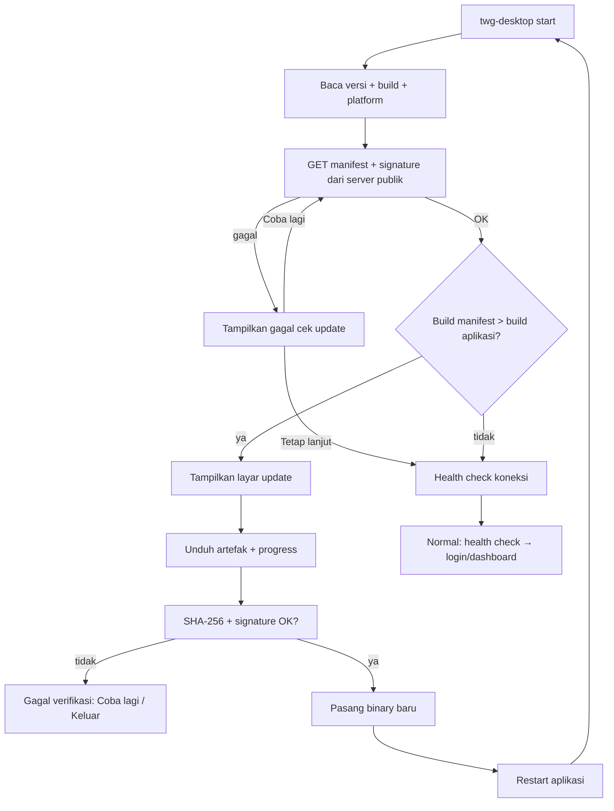

# Konsep auto-update `twg-desktop`

Status: **Fase 1 + jalur Windows implemented; Linux/macOS sudah disiapkan, menunggu uji di OS masing-masing.**

## Implementasi saat ini

- Server: `UPDATES_DIR` (default `updates`) + route `/updates/*` (tanpa auth).
- Client: crate `crates/twg-update` (manifest, signature, unduhan, instalasi)
  dan `apps/desktop/src/update.rs` (layar update + gate sebelum login).
- Build number: `TWG_BUILD_NUMBER` dari `build.rs` (fallback: jumlah commit
  git).
- Public key: `assets/update-public-key.txt`. Private key default
  `dist/keys/twg-update-signing-key.pem` — **jangan di-commit** dan simpan
  cadangannya; kalau hilang, client harus dibangun ulang dengan public key
  baru.
- Publish: `node tools/publish-update.mjs ...` (membuat manifest + signature).
- Env client: `TWG_UPDATE_URL` (override manifest), `TWG_SKIP_UPDATE`,
  `TWG_UPDATE_CACHE`.
- Build debug hanya menjalankan updater bila `TWG_UPDATE_URL` diset; build
  release selalu memeriksa update.
- Windows: unduh → verifikasi → ganti exe → restart sudah diuji end-to-end.

Tujuan: setiap `twg-desktop` dijalankan, aplikasi memeriksa update dari server
publik. Jika ada build baru yang valid untuk platform tersebut, aplikasi
**wajib** mengunduh dan memasangnya sebelum halaman login/dashboard muncul.
Jika tidak ada update, alur berjalan seperti sekarang (health check → login →
workspace).

## 0. Keputusan yang sudah disepakati

| Topik | Keputusan |
|---|---|
| Cek update gagal / offline | Tampilkan peringatan; pengguna boleh **Tetap lanjut** |
| Transport | HTTP + signature Ed25519 untuk sekarang; domain + TLS menyusul |
| macOS signing | Belum ada Apple Developer account; implementasi dulu tanpa notarization, dengan peringatan Gatekeeper |
| Linux | **AppImage** sebagai artefak utama; binary per-user tetap didukung sebagai alternatif |
| Hosting artefak | VPS dulu; nanti bisa VPS + GitHub Releases |
| Sifat update | Semua rilis wajib (`mandatory: true`) |
| `twg-online-admin` | **Tidak** ikut auto-update (hanya untuk user tertentu) |

---

## 1. Ringkasan rekomendasi

| Keputusan | Rekomendasi |
|---|---|
| Bentuk updater | In-app updater (layar update di window yang sama), bukan aplikasi terpisah |
| Urutan startup | `Cek update` → `Unduh` → `Verifikasi` → `Pasang` → `Restart` → health check → login/dashboard |
| Sumber update | Server publik (tetap), tidak mengikuti pilihan Publik/Lokal |
| Format manifest | JSON + tanda tangan Ed25519 (`stable.json` + `stable.json.sig`) |
| Integritas file | SHA-256 di manifest + verifikasi tanda tangan manifest |
| Pembanding versi | Nomor build monotonik (integer), bukan hanya semver |
| Windows | Portable `.exe`; rename exe lama → pasang exe baru → restart |
| Linux | **AppImage** (paling sederhana) atau binary per-user di `~/.local/bin` |
| macOS | Zip berisi `.app`; untuk sekarang belum di-sign/notarized karena belum ada akun Apple |
| Jika server update tidak terjangkau | Tampilkan peringatan, izinkan lanjut |
| Jika update valid ditemukan | Tidak ada tombol lewati; hanya `Coba lagi` / `Keluar` |

Alasan utama memakai signature: server saat ini HTTP tanpa TLS. Tanpa tanda
tangan, siapa pun di jaringan bisa menyajikan binary berbahaya. Tanda tangan
Ed25519 membuat server/binary palsu ditolak walaupun koneksi tidak terenkripsi.

---

## 2. Alur startup



Layar update menggantikan layar login saat fase update. Beberapa state UI:

- `Memeriksa pembaruan...`
- `Versi baru tersedia: 0.2.0 (build 43)`
- `Mengunduh... 35% (24,8 MB / 71,3 MB)`
- `Memverifikasi...`
- `Memasang...`
- `Gagal: ...` + tombol **Coba lagi** dan **Keluar**
- Setelah berhasil: aplikasi restart otomatis; proses baru langsung masuk ke
  pengecekan koneksi → login/dashboard.

Catatan: update dilakukan **sebelum** login, jadi tidak ada sesi/WebSocket yang
perlu ditutup. Session file di komputer tidak disentuh.

---

## 3. Sisi server

### 3.1 Penyimpanan

Tambahkan direktori update di server, terpisah dari `ASSETS_DIR`:

```text
/var/lib/twg/updates/twg-desktop/
  stable.json
  stable.json.sig
  0.2.0/
    twg-desktop-0.2.0-windows-x86_64.exe
    twg-desktop-0.2.0-linux-x86_64.AppImage
    twg-desktop-0.2.0-macos-aarch64.app.zip
    twg-desktop-0.2.0-macos-x86_64.app.zip
```

Konfigurasi baru: `UPDATES_DIR=/var/lib/twg/updates` (default `updates`).

Route Axum baru (tanpa auth):

```text
GET /updates/twg-desktop/stable.json
GET /updates/twg-desktop/stable.json.sig
GET /updates/twg-desktop/<version>/<file>
```

Gunakan `ServeDir` seperti `/assets`. Header:

- `stable.json` / `.sig`: `Cache-Control: no-cache` (supaya update langsung
  terlihat).
- File artefak ber-version: `Cache-Control: public, max-age=31536000,
  immutable`.
- Pastikan `Content-Length` dan `Content-Type` benar.

### 3.2 Manifest

```json
{
  "schema": 1,
  "channel": "stable",
  "version": "0.2.0",
  "build": 43,
  "min_supported_build": 40,
  "mandatory": true,
  "published_at": "2026-11-20T03:00:00Z",
  "notes": "Perbaikan water cannon dan stabilitas koneksi.",
  "platforms": {
    "windows-x86_64": {
      "kind": "exe",
      "url": "http://103.179.218.76:8122/updates/twg-desktop/0.2.0/twg-desktop-0.2.0-windows-x86_64.exe",
      "size": 71341888,
      "sha256": "…"
    },
    "linux-x86_64-appimage": {
      "kind": "appimage",
      "url": "http://103.179.218.76:8122/updates/twg-desktop/0.2.0/twg-desktop-0.2.0-linux-x86_64-appimage.AppImage",
      "size": 0,
      "sha256": "…"
    },
    "macos-aarch64": {
      "kind": "app-zip",
      "url": "http://103.179.218.76:8122/updates/twg-desktop/0.2.0/twg-desktop-0.2.0-macos-aarch64.app.zip",
      "size": 0,
      "sha256": "…"
    }
  }
}
```

`stable.json.sig` = tanda tangan Ed25519 (base64) atas **byte mentah**
`stable.json`. Public key ditanam di binary aplikasi; private key hanya ada di
mesin/CI rilis.

Aturan update:

- `manifest.build > current_build` → ada update.
- `mandatory == true` **atau** `current_build < min_supported_build` → tidak
  boleh dilewati.
- `manifest.build <= current_build` → tidak ada update (tolak downgrade).
- Platform yang tidak ada di `platforms` → tidak ada update untuk platform itu
  (jangan menampilkan update yang tidak bisa dipasang).

Linux memakai dua key terpisah supaya updater tidak menimpa AppImage dengan
binary mentah atau sebaliknya: `linux-x86_64-appimage` (env `APPIMAGE` ada) dan
`linux-x86_64-binary` (dijalankan sebagai file biasa).

### 3.3 Publikasi rilis

Skrip `tools/publish-update.mjs` (atau `.ps1`/`.sh`) melakukan:

1. Terima path artefak hasil build + nomor versi/build.
2. Hitung SHA-256 dan ukuran.
3. Tulis manifest.
4. Tanda tangani manifest dengan private key dari env/secret.
5. Upload artefak + manifest + signature ke VPS (scp/rsync).
6. Upload manifest **terakhir** secara atomik (rename di server), supaya client
   tidak pernah melihat manifest yang menunjuk file yang belum ada.

Jika bandwidth VPS terbatas, alternatif: manifest tetap di VPS, sedangkan URL
artefak menunjuk GitHub Releases/object storage. Signature + hash tetap
menjamin integritas; ini juga memberi CDN gratis.

---

## 4. Sisi client

### 4.1 Versi dan build

- `CARGO_PKG_VERSION` untuk versi tampilan (mis. `0.2.0`).
- Nomor build integer yang monotonik:
  - CI: `TWG_BUILD_NUMBER` (mis. GitHub run number), atau
  - build.rs lokal: `git rev-list --count HEAD`.
- build.rs menulis `cargo:rustc-env=TWG_BUILD_NUMBER=...`.
- Platform key runtime:
  `windows-x86_64`, `linux-x86_64-appimage`, `linux-x86_64-binary`,
  `macos-aarch64`, `macos-x86_64`.
- Tampilkan versi + build di layar update dan nanti di menu Pengaturan.

### 4.2 Pengecekan dan unduhan

- Endpoint update **tidak** memakai `ClientUi.api` yang terikat koneksi
  Publik/Lokal. Buat HTTP client kecil khusus update (`ureq`), dengan override
  `TWG_UPDATE_URL` untuk staging/testing.
- Timeout cek manifest pendek (mis. 8 detik) agar startup tidak menggantung.
- Unduh ke file sementara di direktori cache/temp:
  `%LOCALAPPDATA%\twg\updates\...` (Windows),
  `~/.cache/twg/updates/...` (Linux),
  `~/Library/Caches/twg/updates/...` (macOS).
- Progress dihitung dari `Content-Length`.
- Verifikasi:
  1. SHA-256 file == manifest.
  2. Signature manifest valid dengan public key bawaan.
  3. Baru setelah itu file boleh dipindahkan/dipasang.
- Jika verifikasi gagal: hapus file sementara, tampilkan error, **jangan**
  pasang.

### 4.3 Pemasangan per platform

**Windows (portable exe)**

1. Unduh `twg-desktop.exe` baru ke folder sementara.
2. Verifikasi.
3. `Rename` exe yang sedang berjalan menjadi
   `twg-desktop.exe.old-<build>` (Windows mengizinkan rename exe yang sedang
   berjalan).
4. Pindahkan exe baru ke path asli.
5. `Command::new(current_exe).spawn()` lalu keluar.
6. Saat startup berikutnya, hapus file `.old-*`.

Catatan:

- Jika aplikasi berada di `Program Files` atau folder yang butuh admin, rename
  bisa gagal. Rekomendasi: distribusikan sebagai portable exe di folder user.
- Antivirus dapat mengunci file sebentar: beri retry singkat dan pesan jelas.

**Linux**

### Perbandingan: AppImage vs binary per-user

| Aspek | AppImage | Binary per-user (`~/.local/bin`) |
|---|---|---|
| Kecepatan unduh/update | Biasanya lebih kecil (squashfs + zstd, satu file) | Tergantung kompresi tar; bisa setara |
| Kecepatan start | Sedikit lebih lambat karena mount FUSE (~0,1–0,5 dtk) | Paling cepat, tanpa mount |
| Risiko | Butuh `libfuse2`; jika tidak ada, fallback ekstrak (lebih lambat) | Tidak ada dependensi tambahan |
| Proses update | Ganti satu file, atomik | Ganti satu file; ikon/.desktop terpisah |
| Instalasi | Satu file, `chmod +x` | `install.sh`; ikon + menu sudah ditangani |
| Integrasi menu | Perlu `.desktop`/AppImage launcher | Sudah ditangani `install.sh` |

**Saran:** pakai **AppImage sebagai artefak auto-update utama** karena update
hanya mengganti satu file dan ukuran unduhan biasanya lebih kecil. Tetap
sediakan tar.gz + `install.sh` untuk pengguna yang tidak mau AppImage. Updater
mendeteksi env `APPIMAGE`: jika berjalan sebagai AppImage, ganti file AppImage;
 jika berjalan sebagai binary per-user dan foldernya bisa ditulis, ganti
binary tersebut; selain itu tampilkan instruksi update manual.

Rekomendasi utama: **AppImage** — satu file, bisa diganti atomik, tidak butuh
root.

1. Unduh AppImage baru.
2. Verifikasi.
3. `chmod +x`.
4. `rename` file AppImage lama → `.old`, lalu pindahkan yang baru.
5. Spawn ulang file yang baru, keluar.

Jika tetap memakai tar.gz + binary:

- Hanya bisa auto-update jika dipasang per-user, mis. `~/.local/bin/twg-desktop`
  (`install.sh` saat ini mendukung `PREFIX`).
- Jika dipasang di `/usr/local/bin` (root), updater tidak punya izin menulis.
  Tampilkan pesan: "Update otomatis tidak tersedia untuk instalasi sistem;
  jalankan install.sh versi baru."
- Jangan mencoba `sudo`/pkexec diam-diam.

**macOS**

Rekomendasi: zip berisi `.app` yang sudah **Developer ID signed + notarized**.

1. Unduh zip ke temp, ekstrak `.app` baru.
2. Verifikasi hash/signature manifest, lalu verifikasi code signature bundle
   (mis. `codesign --verify --deep --strict` atau Security framework).
3. Rename `.app` lama → `.old`, pindahkan `.app` baru.
4. Jalankan `open -n "…/Tactical Game 3D.app"`, lalu keluar.

Catatan penting:

- Belum ada Apple Developer account, jadi tahap awal bundle belum
  di-sign/notarized. Update tetap bisa mengganti bundle, tetapi Gatekeeper
  dapat memblokir atau menampilkan peringatan saat aplikasi dibuka pertama
  kali. Ini harus diuji di macOS; signing/notarization menyusul saat akun
  tersedia.
- Jika `.app` berada di `/Applications` dan user tidak punya izin tulis,
  auto-update gagal. Pilihan: pasang di `~/Applications`, atau gunakan helper
  yang meminta otorisasi admin (lebih rumit).
- Untuk tahap awal, macOS bisa memakai alur "unduh + arahkan ke installer"
  sampai signing/notarization siap.

### 4.4 Gate UI di Bevy

- Updater sebaiknya berada di `apps/desktop` (desktop-only), bukan di
  `twg-ui` (yang juga dikompilasi untuk wasm).
- Buat `UpdatePlugin` + resource `UpdateState` dan `UpdateGate`.
- Gambar layar update penuh di `EguiPrimaryContextPass`; sistem `draw_client_shell`
  hanya jalan jika gate terbuka.
- Unduh/verifikasi di thread terpisah; UI membaca progress dari
  `Arc<Mutex<UpdateProgress>>` atau channel.
- Setelah memasang, `AppExit::Success`; proses baru akan menjalankan alur normal.

Alternatif yang lebih sederhana untuk tahap 1: integrasikan state update ke
`Screen::Boot` di `twg-ui` (sebelum health check), lalu pindahkan ke plugin
terpisah jika sudah stabil. Saya merekomendasikan plugin terpisah agar logika
login tidak tercampur dengan file I/O updater.

---

## 5. Keamanan

1. **Wajib tanda tangan manifest** (Ed25519). Jangan pernah memasang binary
   yang tidak lolos verifikasi.
2. **Wajib verifikasi SHA-256** file setelah unduh.
3. **TLS sangat disarankan.** Server saat ini HTTP; minimal update endpoint
   sebaiknya HTTPS (domain + Caddy/Nginx, atau Cloudflare). Tanpa TLS,
   signature tetap melindungi integritas, tetapi metadata dan ketersediaan
   masih bisa diganggu.
4. **Anti-rollback**: tolak manifest dengan `build` lebih kecil dari build
   aplikasi. Simpan build terakhir yang berhasil dipasang.
5. **Code signing OS**: Authenticode (Windows), Developer ID + notarization
   (macOS). Ini berbeda dari signature updater; keduanya diperlukan untuk
   pengalaman yang mulus.
6. **Private key** hanya di CI/secret, tidak pernah di repo atau di VPS.
7. **Jangan minta admin/root** untuk update; gunakan instalasi per-user.
8. Batasi ukuran download dan validasi `Content-Length`/disk space sebelum
   menulis.

---

## 6. Kebijakan saat gagal cek / offline

Ini keputusan penting:

- **Rekomendasi**: jika manifest tidak bisa diambil (server mati/jaringan
  putus), tampilkan peringatan dan izinkan pengguna **Tetap lanjut**. Alasannya:
  memblokir total dapat membuat aplikasi tidak bisa dipakai sama sekali,
  terutama saat memakai server Lokal.
- Jika manifest **berhasil** diambil dan menyatakan update wajib, jangan
  izinkan lanjut; hanya **Coba lagi** atau **Keluar**.
- Jika unduhan gagal di tengah jalan: tombol **Coba lagi**; file parsial
  dihapus saat aplikasi ditutup.
- Jika verifikasi gagal: blokir update tersebut, tampilkan error, dan tetap
  izinkan cek ulang (jangan pernah memasang file yang gagal verifikasi).

Kalau Anda ingin aplikasi **selalu** online dan memblokir saat server update
mati, itu bisa diubah, tetapi risikonya lebih besar.

---

## 7. Release pipeline

Karena artefak harus dibangun di OS masing-masing:

1. Tag rilis (mis. `v0.2.0`) atau push ke branch `release`.
2. CI matrix: Windows, Linux, macOS (arm64 + x86_64 bila perlu).
3. Build release + jalankan packaging script yang sudah ada.
4. Upload artefak ke VPS/GitHub Releases.
5. `tools/publish-update.*` membuat `stable.json` + signature.
6. Upload manifest terakhir secara atomik.
7. Smoke test: jalankan client versi lama di tiap OS dan pastikan update
   terdeteksi, terverifikasi, terpasang, dan restart.

Tanpa CI, langkah ini harus dijalankan manual di tiap OS; CI matrix jauh lebih
aman dan konsisten.

---

## 8. Pengujian minimum

- Tidak ada update → langsung ke login.
- Ada update → layar update muncul, login tidak bisa diakses.
- Signature manifest salah → ditolak.
- SHA-256 file salah → ditolak.
- Manifest lebih lama dari build saat ini → tidak downgrade.
- Server update mati → sesuai kebijakan (peringatan + lanjut / blokir).
- Download terputus → bisa retry, tidak ada file rusak yang dipasang.
- Windows: exe terkunci antivirus, folder read-only.
- Linux: instalasi per-user vs `/usr/local`.
- macOS: bundle di `~/Applications` vs `/Applications`, Gatekeeper.
- Restart otomatis membuka versi baru, lalu login/dashboard normal.

---

## 9. Tahapan implementasi yang disarankan

**Fase 1 — Fondasi (tanpa memasang binary)**

- Tambah build number + platform key.
- Endpoint `UPDATES_DIR` + manifest + signature.
- Skrip publish + public key di client.
- Layar "cek update" + verifikasi manifest/artefak.
- Mode `TWG_UPDATE_DRY_RUN=1` untuk uji tanpa mengganti file.

**Fase 2 — Windows**

- Self-replace exe + restart + cleanup `.old`.
- Uji dengan server lokal dan file palsu.

**Fase 3 — Linux**

- AppImage atau binary per-user; deteksi instalasi read-only.

**Fase 4 — macOS**

- Bundle `.app`, signing/notarization, replace + `open`.

**Fase 5 — Otomasi & keamanan**

- CI matrix, publish otomatis, TLS/domain update, rollback/watchdog,
  audit log update di server.

---

## 10. Keputusan & hal yang masih terbuka

Sudah diputuskan:

1. Cek update gagal / offline: peringatan + **Tetap lanjut**.
2. Transport: HTTP + signature Ed25519; TLS menyusul.
3. macOS: belum ada Apple Developer account; implementasi tanpa notarization
   dulu, dengan catatan Gatekeeper.
4. Linux: AppImage utama, binary per-user sebagai alternatif.
5. Artefak: VPS dulu; GitHub Releases menyusul.
6. Semua rilis wajib update.
7. `twg-online-admin` tidak ikut auto-update.

Masih terbuka (bisa menyusul setelah fase awal):

- Domain + TLS untuk endpoint update.
- Apple Developer account untuk signing/notarization macOS.
- CI matrix vs publish manual di tiap OS.
- Kapan artefak dipindah/ diduplikasi ke GitHub Releases.
- Apakah perlu rollback otomatis/watchdog jika build baru gagal start.

Setelah keputusan di atas, implementasi bisa dimulai dari Fase 1 (Windows
didahulukan karena itu platform yang sedang dipakai).
