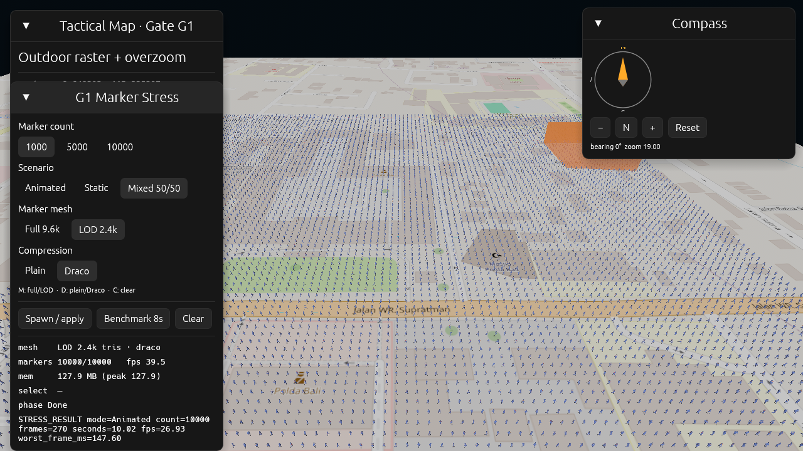
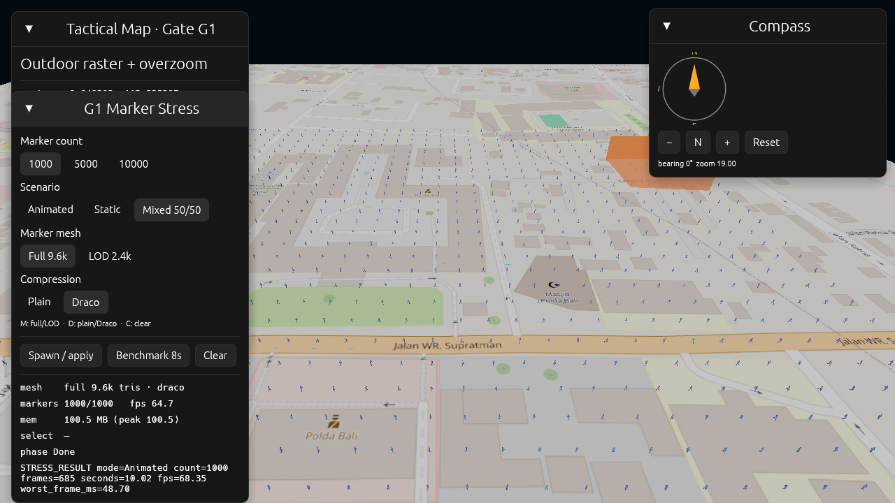

# Laporan Draco + LOD — marker glTF

Dokumen ini mencatat hasil integrasi loader
`KHR_draco_mesh_compression` dan pengujiannya dengan serta tanpa LOD, di
desktop dan web.

## Ringkasan

- Loader Draco di-vendor sebagai `crates/twg-gltf-draco` dari
  [`bevy_gltf_draco`](https://github.com/jiangheng90-opensource/bevy_gltf_draco)
  0.2.1, dengan patch untuk Bevy 0.20.
- `--probe-draco` memuat 8 model (plain/Draco × full/LOD × idle/walk):
  **8/8 PASS**.
- Draco tidak mengubah jumlah triangle. Dampaknya hanya pada ukuran unduhan
  dan biaya decode satu kali; FPS steady-state setara dengan model non-Draco.
- Di web, LOD tetap wajib untuk grup besar. Dengan 10.000 marker, Draco+LOD
  mencapai ~27 FPS, sedangkan full-detail hanya ~7 FPS.
- Rekomendasi produksi: **LOD2 plain** sebagai default; aktifkan Draco bila
  bandwidth lebih penting daripada waktu decode dan payload decoder.

## Implementasi

| Bagian | Perubahan |
|---|---|
| `crates/twg-gltf-draco` | Plugin hasil vendor, dual-license MIT/Apache-2.0 |
| `twg-render` | Mendaftarkan `GltfDracoDecoderPlugin` di `TacticalRenderPlugin` |
| `stress/gltf.rs` | Helper `load_gltf` memakai `load_builder().with_settings(validate = false)` hanya untuk file Draco |
| `stress/config.rs` | `MarkerModelSet` kini punya `lod` dan `draco`, dengan konstanta `FULL`, `LOD`, `FULL_DRACO`, `LOD_DRACO` |
| `stress/probe.rs` | Probe 8 model, timeout 15 detik |
| UI | Baris **Compression: Plain / Draco**; tombol `D` untuk toggle, `M` tetap untuk LOD |
| Desktop | Flag `--draco` / `--no-draco` |
| Web | Query `?draco=1`, status `document.title` memuat `draco=0|1` |

Catatan teknis:

- Bevy 0.20 mengubah hook ekstensi menjadi
  `impl ConditionalSendFuture<Output = ()>`; `async fn` tidak lagi kompatibel.
  Versi vendored sudah memakai bentuk baru.
- Validator glTF menolak `extensionsRequired` Draco sebelum handler berjalan,
  sehingga file Draco wajib dimuat dengan `validate = false`.
- Di WebAssembly, decode dijalankan lewat `spawn_local` dan hasilnya dikirim
  melalui one-shot channel; `futures` hanya menjadi dependency wasm.
- Di native, `draco_decoder` mengompilasi decoder C++ lewat `cxx`/`cmake`.

## Ukuran dan geometri

| Varian | Ukuran | Triangle | Vertex (ter-decode) |
|---|---:|---:|---:|
| walk full plain | 711 KB | 9.628 | 5.961 |
| walk full Draco | 251 KB | 9.628 | 6.010 |
| idle full plain | 336 KB | 9.628 | — |
| idle full Draco | 82 KB | 9.628 | — |
| walk LOD2 plain | 304 KB | 2.404 | 1.976 |
| walk LOD2 Draco | 204 KB | 2.404 | 1.980 |
| idle LOD2 plain | 113 KB | 2.406 | 1.969 |
| idle LOD2 Draco | 52 KB | 2.406 | 1.978 |

Penghematan ukuran: 33% (walk LOD2) sampai 76% (idle full). Triangle identik;
selisih beberapa vertex berasal dari kuantisasi Draco yang memecah sebagian
vertex bersama.

## Probe native

```bash
TWG_ASSET_PATH=F:/twgrev/assets ./target/debug/twg-desktop.exe \
  --probe-draco --exit
```

```text
DRACO_PROBE polwan_airud_idle_non_draco.glb: PASS
DRACO_PROBE polwan_airud_walk_non_draco.glb: PASS
DRACO_PROBE polwan_airud_idle_lod2.glb: PASS
DRACO_PROBE polwan_airud_walk_lod2.glb: PASS
DRACO_PROBE polwan_airud_idle_draco.glb: PASS
DRACO_PROBE polwan_airud_walk_draco.glb: PASS
DRACO_PROBE polwan_airud_idle_lod2_draco.glb: PASS
DRACO_PROBE polwan_airud_walk_lod2_draco.glb: PASS
```

Waktu muat + bake 20 frame pada native (full walk + idle, dari log startup
sampai `baked 20 animation frames`):

- plain: ~285 ms
- Draco: ~317 ms

Jadi overhead decode native berada di bawah 50 ms untuk model ini.

## Benchmark native

Build debug (`opt-level = 1`, dependency `opt-level = 3`), GTX 1660 Ti,
`PresentMode::AutoNoVsync`, warmup 2 s, sample 6 s, zoom 19, mode Animated.

| Varian | 1.000 | 5.000 | 10.000 |
|---|---:|---:|---:|
| Draco + LOD2 | 250,34 FPS | 198,39 FPS | 101,88 FPS |
| Draco full | 242,99 FPS | 64,85 FPS | 33,48 FPS |
| Plain full (pembanding) | — | — | 34,49 FPS |

Draco full dan plain full berada dalam noise pengukuran (33,48 vs 34,49 FPS),
sehingga beban render ditentukan oleh jumlah triangle, bukan kompresi file.

## Benchmark web

Chrome headless, ANGLE D3D11, GTX 1660 Ti, WebGL 2.0, warmup 3 s, sample 10 s,
zoom 19, layer OSM.

### Draco + LOD2

| Mode | 1.000 | 5.000 | 10.000 |
|---|---:|---:|---:|
| Animated | 99,74 | 54,08 | 26,93 |
| Static | 99,99 | 49,60 | 27,47 |
| Mixed 50/50 | 99,89 | 51,68 | 26,08 |

Data mentah:
[`web-stress-results-draco-lod.json`](web-stress-results-draco-lod.json),
[`web-stress-results-draco-lod.md`](web-stress-results-draco-lod.md).



### Draco full (tanpa LOD)

| Mode | 1.000 | 5.000 | 10.000 |
|---|---:|---:|---:|
| Animated | 68,35 | 14,26 | 7,23 |
| Static | 65,19 | 13,22 | 6,82 |
| Mixed 50/50 | 64,97 | 13,64 | 7,43 |

Data mentah:
[`web-stress-results-draco-full.json`](web-stress-results-draco-full.json),
[`web-stress-results-draco-full.md`](web-stress-results-draco-full.md).



### Perbandingan dengan non-Draco pada mesin yang sama

Pengukuran ulang non-Draco + LOD2 pada sesi yang sama memberi
99,81 / 57,02 / 29,49 FPS untuk 1.000 / 5.000 / 10.000 Animated. Hasil
Draco+LOD2 (99,74 / 54,08 / 26,93) berada dalam ±10%, jadi perbedaan utama
berasal dari kondisi mesin/Chrome, bukan dari Draco.

Angka historis di [`WEB_STRESS_REPORT.md`](WEB_STRESS_REPORT.md)
(50,60 FPS pada 10.000 Animated) diukur pada sesi yang lebih dingin; angka itu
tidak boleh dibandingkan langsung dengan tabel di atas tanpa menjalankan ulang
kedua varian pada sesi yang sama.

## Regresi input web

`node tools/web-stress.mjs --only=static:1000 --draco=0 --lod=1` dengan
`--wheel-test --pan-test --lod-toggle-test --draco-toggle-test --select-test
--memory-test --fly-test --proxy-test`:

| Tes | Hasil |
|---|---|
| Wheel zoom | PASS (19 → 19,45 → 18,55) |
| Pan bearing 45° | PASS (maju dan mundur) |
| Toggle LOD `M` | PASS (`lod=0` → `lod=1`) |
| Toggle Draco `D` | PASS (`draco=0` → `draco=1`, 1.000 marker siap) |
| Selection | PASS (marker #528) |
| Memory load/unload | PASS (136,2 / 136,2 MB) |
| Tile proxy | PASS (81 tile lewat proxy) |
| Fly-to/compass | PASS |

Data mentah: [`web-stress-results-draco-regression.json`](web-stress-results-draco-regression.json).

## Reproduksi

```bash
# Probe 8 model
TWG_ASSET_PATH=F:/twgrev/assets ./target/debug/twg-desktop.exe \
  --probe-draco --exit

# Native: Draco + LOD
TWG_ASSET_PATH=F:/twgrev/assets ./target/debug/twg-desktop.exe \
  --stress animated --count 10000 --benchmark --exit --lod --draco \
  --zoom 19 --warmup 2 --sample 6

# Native: Draco full
TWG_ASSET_PATH=F:/twgrev/assets ./target/debug/twg-desktop.exe \
  --stress animated --count 10000 --benchmark --exit --full --draco \
  --zoom 19 --warmup 2 --sample 6

# Web: matriks Draco + LOD
node tools/web-stress.mjs --lod=1 --draco=1 --tag=draco-lod --sample=10

# Web: matriks Draco full
node tools/web-stress.mjs --lod=0 --draco=1 --tag=draco-full --sample=10

# Web: regresi input + toggle Draco
node tools/web-stress.mjs --only=static:1000 --lod=1 --draco=0 \
  --draco-toggle-test --lod-toggle-test --pan-test --wheel-test
```

## Kesimpulan

1. Draco dapat dimuat di desktop dan web Bevy 0.20 tanpa perubahan pipeline
   render; material, skin, dan animasi tetap terbaca.
2. Keuntungan Draco adalah ukuran unduhan (33-76% lebih kecil), bukan FPS.
3. LOD2 tetap syarat untuk 10.000 marker di web; full-detail gagal mencapai
   lantai 25-30 FPS bahkan tanpa Draco.
4. Kombinasi produksi yang disarankan: **LOD2 plain** secara default, dengan
   opsi **LOD2 Draco** untuk jaringan lambat.
