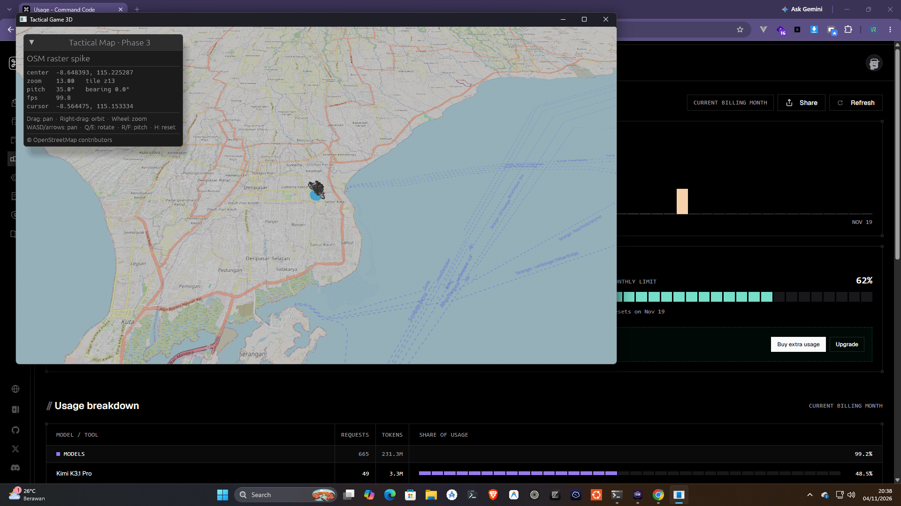

# Laporan Fase 3 — Spike `twg-map` dan Gate G1

**Tanggal:** 4 November 2026  
**Status:** native PASS; WASM compile + bundle PASS; runtime browser belum
diverifikasi karena `agent-browser` belum terpasang di mesin ini.  
**Keputusan sementara:** lanjutkan Bevy + `twg-map` dari awal. Gate G1 belum
ditutup penuh sampai runtime web dan target FPS resmi disepakati.



## Hasil yang sudah dibuktikan

| Area | Hasil |
|---|---|
| Core geospasial | `GeoPoint`, WGS84 → Web Mercator, tile fraction, `TileId`, parent/children, local offset |
| Tile source | XYZ OSM tanpa API key, attribution, URL substitution |
| Tile cover | 11×11 tile di sekitar kamera, wrap longitude, dedup di zoom rendah |
| Kamera | center, zoom, pitch, bearing; pan, orbit, pitch, wheel zoom, keyboard, reset |
| Renderer | Bevy 0.20 + `bevy_egui` 0.43, tile raster, fallback ground, marker GLTF |
| Tile loading | Bevy `https` asset source; native `ureq`, web `fetch`; native disk cache `.web-asset-cache` |
| Marker | GLB non-Draco dengan dua clip animasi dan embedded JPEG valid |
| Cursor | ray → bidang peta → latitude/longitude di UI |
| FPS | overlay `FrameTimeDiagnosticsPlugin`; sekitar 100 FPS pada GTX 1660 Ti, 6–8 detik setelah load |
| Test core | 17 test `twg-map` PASS |
| Dependency policy | `cargo deny check` PASS; `CDLA-Permissive-2.0` ditambahkan untuk `webpki-root-certs` |
| Native | desktop berjalan tanpa panic; tile OSM dan marker tampil |
| WASM | `cargo check --target wasm32-unknown-unknown` PASS |
| Web bundle | `trunk build` PASS; aset GLB tersalin ke `dist/assets` |

## Bukti perintah

```text
cargo test -p twg-map
  17 passed; 0 failed

cargo check -p twg-map -p twg-render -p twg-ui -p twg-desktop
  PASS

cargo clippy -p twg-map -p twg-render -p twg-ui -p twg-desktop -- -D warnings
  PASS

cargo check -p twg-web --target wasm32-unknown-unknown
  PASS

trunk build
  ✅ success
```

Log runtime native setelah perbaikan path aset dan pemilihan GLB yang valid
tidak menunjukkan error `bevy_asset` atau `bevy_gltf`.

## Struktur baru

`twg-map` dipecah menjadi:

- `geo.rs` — koordinat, Mercator, tile math, jarak, local offset.
- `tile.rs` — `TileSource`, `XyzTileSource`, `TileCover`, `cover_tiles`.
- `camera.rs` — `MapCameraState`, `MapCursor`, pan/zoom/rotate/pitch, world ↔ geo.

`twg-render` dipecah menjadi:

- `map/camera.rs` — komponen kamera dan transform.
- `map/input.rs` — mouse, wheel, keyboard.
- `map/cursor.rs` — picking bidang peta.
- `map/tiles.rs` — tile world, spawn/despawn, transform.
- `map/marker.rs` — marker GLTF dan rotasi.
- `map/environment.rs` — ambient, directional light, fallback ground.
- `map/mod.rs` — plugin, resource adapter Bevy (`MapCameraResource`, `MapCursorResource`).

## Gate G1

| Kriteria | Status |
|---|---|
| Peta raster tampil benar di native | PASS — screenshot di atas |
| Peta raster tampil di WASM | Compile + bundle PASS; runtime browser belum diuji |
| Kamera pitch/bearing/zoom konsisten | PASS di native |
| Picking dan transform dasar | Cursor lat/lon PASS; object picking belum |
| Target FPS dan memori tercapai | FPS sekitar 100 terukur; target resmi dan memori belum disepakati |
| Tidak ada bug presisi koordinat terlihat | PASS pada zoom 13 dan 19 |
| Jalur fallback WebGL2 | Belum diuji |
| Tidak ada blocker yang memaksa ganti stack | PASS sejauh native |

## Keterbatasan dan pekerjaan lanjutan

- Runtime browser belum diuji karena `agent-browser` belum terpasang. Ini bukan
  blocker arsitektur; instal `npm i -g agent-browser && agent-browser install`
  untuk menyelesaikan uji WASM.
- Bundle WASM debug berukuran sekitar 155 MB. Build release + `wasm-opt`
  dikerjakan pada fase packaging.
- Tile di tepi viewport masih memakai fallback ground gelap. Untuk produksi,
  tambahkan tile proxy, cache, dan layer zoom lebih rendah sebagai backdrop.
- Object picking, selection outline, line, polygon, dan 1.000 marker belum
  diimplementasikan.
- Clip animasi GLB sudah termuat, tetapi playback belum diaktifkan. Animasi
  runtime masuk Fase 10.
- Rate limit OSM: spike memuat 121 tile per perubahan zoom. Produksi wajib
  memakai tile proxy/cache dan attribution yang terlihat.
- `WebAssetPlugin` mencetak peringatan keamanan saat startup. URL tile berasal
  dari template tetap, bukan input pengguna.

## Perintah menjalankan

```bash
cargo run -p twg-desktop
```

Desktop memakai `../../assets` relatif terhadap executable. Override dengan:

```powershell
$env:TWG_ASSET_PATH = "F:\twgrev\assets"
cargo run -p twg-desktop
```

Web:

```bash
cd apps/web
trunk serve
```
