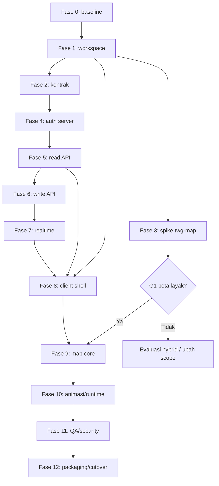

# Checklist Implementasi Migrasi Rust — Tactical Game 3D

**Status:** siap dieksekusi  
**Stack disetujui:** Axum + Tokio + SQLx + PostgreSQL, Bevy + egui, `twg-map` dari awal  
**Sumber referensi:** `E:\tactical_game` (read-only)  
**Aturan utama:** jangan mengubah `E:\tactical_game`; semua pekerjaan dilakukan di workspace Rust baru.

> Checklist ini adalah urutan kerja dan gerbang keputusan. Sebuah fase belum
> boleh dianggap selesai hanya karena kode sudah ditulis; harus ada bukti
> verifikasi yang disebutkan pada bagian **Exit gate**.

---

## 0. Aturan eksekusi

- [ ] Gunakan satu Cargo workspace untuk seluruh crate.
- [ ] Jangan memindahkan atau menyalin folder `.git` lama secara sembarangan.
- [ ] Jangan mengubah skema database selama fase kompatibilitas.
- [ ] Jangan menghapus server Go, client React, atau Centrifugo sebelum cutover
      dinyatakan berhasil.
- [ ] Jangan menyimpan secret di repository.
- [ ] Jangan memulai rewrite UI penuh sebelum spike peta lulus gate.
- [ ] Setiap endpoint yang dimigrasikan harus memiliki test kontrak.
- [ ] Setiap aturan role/satker harus memiliki test positif dan negatif.
- [ ] Setiap fase berakhir dengan review, dokumentasi, dan commit yang dapat
      di-rollback.

### Definition of Done umum

Sebuah task dianggap selesai bila:

1. Implementasi sudah direview.
2. Test relevan lulus.
3. `cargo fmt --check` dan `cargo clippy` bersih.
4. Tidak ada warning baru.
5. Dokumentasi/ADR diperbarui.
6. Tidak ada secret atau data produksi masuk repository.
7. Perilaku lama yang relevan tercatat di contract test.

---

## 1. Ringkasan fase

| Fase | Fokus | Gate |
|---|---|---|
| 0 | Persiapan, baseline, dan pengamanan | Baseline lengkap |
| 1 | Workspace Rust dan fondasi CI | Native + WASM hello-world lulus |
| 2 | Kontrak domain dan API | Golden contract test lulus |
| 3 | Spike `twg-map` | **G1: peta layak** |
| 4 | Server auth dan session | Auth parity |
| 5 | Server read-only API | Read parity |
| 6 | Server write API dan upload | Write parity |
| 7 | WebSocket dan real-time | Realtime parity |
| 8 | Client shell dan UI non-peta | Alur non-peta lengkap |
| 9 | Map core dan editor | Map editor MVP |
| 10 | Animasi dan runtime | Runtime parity |
| 11 | QA lintas platform dan keamanan | Release candidate |
| 12 | Packaging, cutover, dan dekomisioning | Produksi stabil |

**Urutan penting:** fase 3 harus dimulai lebih awal dan boleh berjalan paralel
dengan fase 2/4. Fase 9 tidak boleh dimulai serius sebelum G1 lulus. Fase 8
boleh berjalan paralel dengan fase 5–7 setelah fondasi client tersedia.

---

## 2. Dependency dan critical path

Critical path utama: **baseline → workspace → kontrak → server auth → read/write
→ realtime → client terintegrasi → map/runtime → QA → cutover**. Spike peta
merupakan jalur risiko terpisah yang harus segera membuktikan kelayakan.

---

## 3. Fase 0 — Persiapan, baseline, dan pengamanan

> **Status 4 November 2026:** Fase 0 selesai untuk artefak, database fixture,
> build server lama, golden response, role matrix, error body, dan latency
> server lokal. Source lama tetap bersih. Baseline FPS/memori renderer client
> dan build bundle masih tertunda. Lihat `baseline/phase0-report.md`.
>
> | Area | Status |
> |---|---|
> | Workspace, guardrail, commit baseline | Selesai |
> | Inventaris 111 route dan 580 aset | Selesai |
> | Fixture SQL dan akun enam role | Selesai |
> | Database fixture Podman/PostgreSQL 18.4 | Selesai |
> | Golden response/error | Selesai — 81 respons, verifikasi PASS |
> | Latency server lokal | Selesai |
> | WebSocket runtime | Selesai — Centrifugo v6.2.5 |
> | Baseline performa renderer client | Tertunda — butuh environment terisolasi |
> | Dead code MapTiler | Hapus, bukan blocker OSM |

### 3.1 Lokasi dan guardrail

- [ ] Tentukan lokasi workspace baru. Rekomendasi: folder sibling
      `E:\tactical_game_rust`, sehingga source lama tetap utuh.
- [ ] Konfirmasi bahwa workspace baru bukan di dalam `E:\tactical_game`.
- [ ] Catat commit hash/tag source lama sebagai baseline referensi.
- [ ] Buat README yang menyatakan source lama bersifat read-only.
- [ ] Buat `.gitignore` untuk target, secret, database dump, dan aset besar.
- [ ] Tentukan strategi branch: `main` stabil dan branch per fase/fitur.
- [ ] Tentukan siapa yang berwenang menyetujui gate.

### 3.2 Baseline perilaku dan data

- [ ] Inventarisasi seluruh route Go: auth, public, private, admin.
- [ ] Catat method, path, request, response, status code, dan role yang diizinkan.
- [ ] Buat fixture database yang bersih dan tidak berisi data produksi.
- [ ] Siapkan pengguna uji untuk kelima role.
- [ ] Siapkan data uji per role, termasuk data dengan `satker_id = NULL`.
- [ ] Ambil golden response untuk endpoint read penting.
- [ ] Ambil golden error response: 400, 401, 403, 404, 409, 500.
- [ ] Catat format pagination, sorting, filter, dan total.
- [ ] Catat perilaku upload gambar/video dan batas ukuran.
- [ ] Catat perilaku refresh token, revoke, logout, dan heartbeat.
- [ ] Catat perilaku `X-Device-ID` dan session per perangkat.
- [ ] Catat semua pesan WebSocket, command, payload, dan urutannya.
- [ ] Catat perilaku reconnect dan pemulihan snapshot jika ada.
- [ ] Dokumentasikan bentuk ganda `BackendUser.units`.
- [ ] Dokumentasikan timestamp, null/omit, UUID, dan format angka.
- [ ] Buat feature parity matrix: halaman/fitur → endpoint → crate Rust → status.

### 3.3 Baseline performa dan aset

- [ ] Ukur performa aplikasi lama pada perangkat referensi:
      FPS, memori, waktu load, jumlah tile, marker, building, dan animasi.
- [ ] Catat ukuran bundle web dan aset terbesar.
- [ ] Inventarisasi semua model GLTF/GLB, tekstur, video, audio, dan skybox.
- [ ] Catat lisensi dan sumber setiap aset.
- [ ] Periksa model yang memakai Draco.
- [ ] Catat provider tile, attribution, dan batas penggunaannya.
- [ ] Hapus dead code MapTiler yang tidak dipakai; OSM tidak membutuhkan API key.
- [ ] Rencanakan tile proxy server dan kuota.

### 3.4 Temuan keamanan awal

- [ ] Catat seluruh secret yang pernah ada di source/config.
- [ ] Pastikan secret tidak disalin ke workspace baru.
- [ ] Evaluasi penyimpanan token di localStorage.
- [ ] Evaluasi channel real-time global dan potensi kebocoran antar-satker.
- [ ] Evaluasi validasi upload dan tipe file.
- [ ] Catat kebutuhan CSP/CORS/Cookie untuk target web.

### Exit gate fase 0

- [ ] Contract fixture dapat dijalankan ulang.
- [ ] Baseline performa dan aset terdokumentasi.
- [ ] Semua risiko kritis memiliki pemilik dan mitigasi.
- [ ] Workspace baru dan aturan read-only disepakati.

---

## 4. Fase 1 — Workspace Rust dan fondasi CI

> **Status 4 November 2026:** 13 package Rust terbentuk. Native check, clippy,
> 21 test inti, WASM check/build, server health smoke, dan desktop smoke lulus.
> `cargo deny check` lulus; `cargo audit` lulus dengan warning unmaintained
> transitif. Trunk belum terpasang, sehingga browser bundle belum diverifikasi.
> Lihat `docs/PHASE1_REPORT.md`.
>
> | Area | Status |
> |---|---|
> | Workspace dan batas crate | Selesai |
> | Server Axum health | Selesai |
> | Desktop Bevy + egui | Selesai |
> | WebAssembly compile/build | Selesai |
> | Browser bundle via Trunk | Tertunda — Trunk belum terpasang |
> | CI workflow | Selesai (belum dijalankan di remote) |
> | Format, clippy, test, deny | PASS |
> | Audit dependency | PASS dengan warning unmaintained |

### 4.1 Workspace

- [ ] Buat `Cargo.toml` workspace.
- [ ] Tentukan Rust toolchain dan target `wasm32-unknown-unknown`.
- [ ] Buat crate kosong: `twg-domain`, `twg-contracts`, `twg-auth`,
      `twg-storage`, `twg-server`, `twg-client`, `twg-map`, `twg-render`,
      `twg-ui`, `twg-asset-pipeline`.
- [ ] Buat binary `apps/server`, `apps/desktop`, `apps/web`.
- [ ] Pisahkan dependency native dan WASM menggunakan `cfg(target_arch = "wasm32")`.
- [ ] Tambahkan `rustfmt.toml`, konfigurasi clippy, dan fitur lint workspace.
- [ ] Tambahkan `cargo-deny` dan `cargo-audit`.
- [ ] Tambahkan README arsitektur dan cara build.

### 4.2 Build minimum

- [ ] Server hello-world Axum berjalan.
- [ ] Desktop hello-world Bevy tampil.
- [ ] Web hello-world Bevy berjalan melalui Trunk/WASM.
- [ ] `cargo check --workspace` lulus.
- [ ] `cargo check --target wasm32-unknown-unknown` untuk crate client/web lulus.
- [ ] `cargo test --workspace` lulus.
- [ ] CI menjalankan fmt, clippy, test, check WASM, audit, dan deny.
- [ ] Cache build CI dikonfigurasi.

### 4.3 Aturan dependensi

- [ ] Pastikan `twg-domain` tidak mengimpor Axum, SQLx, Bevy, atau web API.
- [ ] Pastikan `twg-contracts` tidak mengimpor renderer.
- [ ] Pastikan server tidak mengimpor Bevy.
- [ ] Pastikan `twg-map` tidak melakukan HTTP langsung.
- [ ] Pastikan UI tidak mengakses database/filesystem langsung.
- [ ] Dokumentasikan aturan ini di README/ADR.

### Exit gate fase 1

- [ ] Satu perintah membangun server.
- [ ] Satu perintah membangun desktop.
- [ ] Satu perintah membangun web.
- [ ] CI hijau dari commit bersih.
- [ ] Tidak ada dependency client masuk ke server.

---

## 5. Fase 2 — Kontrak domain, DTO, dan kompatibilitas

> **Status 4 November 2026:** domain dan contracts sudah dipecah per modul.
> Envelope, auth, user, satker, operasi, skenario, map objects, animasi,
> snapshot, last position, WebSocket, dan API paths tersedia. **47 test PASS**,
> termasuk 9 golden HTTP dan 8 request contract. Lihat `docs/PHASE2_REPORT.md`.
>
> | Area | Status |
> |---|---|
> | Domain modular dan scoping role | Selesai |
> | DTO auth/user/satker/operasi/skenario | Selesai |
> | DTO marker/building/line/text/particle | Selesai |
> | DTO animasi/snapshot/last position | Selesai |
> | WebSocket contract | Selesai |
> | API paths | Selesai |
> | `units` adapter | Selesai |
> | Golden contract test | Selesai |
> | Request contract test | Selesai |
> | Golden write endpoint | Tertunda — belum diambil dari server Go |

### 5.1 Domain

- [ ] Definisikan entity: user, satker, operasi, skenario, marker, building,
      line, anim, particle, text marker, snapshot, last position, command.
- [ ] Definisikan enum role dan helper akses.
- [ ] Definisikan policy satker:
      admin/monitor melihat semua; role satker melihat satker sendiri;
      user melihat data `satker_id IS NULL`.
- [ ] Definisikan error domain dan pemetaan status HTTP.
- [ ] Definisikan validasi input per entity.
- [ ] Definisikan tipe koordinat, rotasi, skala, altitude, dan warna.
- [ ] Definisikan aturan transaksi untuk operasi multi-tabel.

### 5.2 Kontrak HTTP

- [ ] Implementasikan `SingleResponse<T>` dan `ListResponse<T>`.
- [ ] Implementasikan envelope error yang sama.
- [ ] Implementasikan API path constants di satu tempat.
- [ ] Implementasikan DTO auth, user, satker, operasi, skenario.
- [ ] Implementasikan DTO marker, building, line, anim, particle, text marker.
- [ ] Implementasikan DTO snapshot, last position, upload, geocode.
- [ ] Tangani `units` string/array dengan adapter yang eksplisit.
- [ ] Pastikan `snake_case`, UUID, timestamp, null, dan omitted field sesuai.
- [ ] Tambahkan snapshot test untuk setiap DTO penting.

### 5.3 Kontrak WebSocket

- [ ] Definisikan pesan client-to-server dan server-to-client.
- [ ] Definisikan command type: reload, route, spawn, remove, combine, sequence,
      shoot, particle, camera, delay.
- [ ] Definisikan field `operasi_id`, `skenario_id`, `marker_id`, `satker_id`.
- [ ] Definisikan version, sequence, timestamp, sender, dan idempotency key.
- [ ] Definisikan pesan presence, join, leave, heartbeat, dan error.
- [ ] Definisikan aturan reconnect dan resume.
- [ ] Tambahkan serialization snapshot test.

### 5.4 Feature parity matrix

- [ ] Buat daftar semua route client dan hubungkan ke endpoint server.
- [ ] Buat daftar semua fitur editor dan runtime.
- [ ] Tandai fitur: wajib, ditunda, atau dihapus.
- [ ] Tandai fitur yang belum ada di source lama tetapi ada di TODO.
- [ ] Setujui cakupan rilis pertama.

### Exit gate fase 2

- [ ] Semua DTO penting memiliki snapshot test.
- [ ] Golden response lama dapat dideserialisasi dan diproduksi ulang.
- [ ] Perbedaan kontrak yang disengaja terdokumentasi.
- [ ] Feature parity matrix disetujui.

---

## 6. Fase 3 — Spike `twg-map` dan gate G1

> **Status 5 November 2026:** spike native dan web sudah menampilkan tile OSM
> dan Esri, kontrol kamera, cursor lat/lon, marker GLB, overlay FPS, cache tile,
> overzoom sampai zoom 26, dan stress test 1k/5k/10k marker. Core `twg-map`
> dipecah menjadi `geo`, `tile`, dan `camera`; 32 test `twg-map` + 5 test
> `twg-render` + 5 test `twg-server` PASS. WASM release build
> dan Chrome WebGL2 PASS; 9/9 skenario stress web PASS dengan minimum 47,19 FPS.
> Gate G1 lulus penuh: peta, FPS, overzoom, presisi, object picking/selection,
> dan pengukuran memori sudah PASS. Seluruh item Fase 3 yang diminta sudah
> diimplementasikan, termasuk fly-to, kompas, quadtree, error tile, rate limit,
> tile proxy, line/polygon, dan floor plan. Matriks browser penuh dan GPU
> integrated masih menjadi pekerjaan pengukuran lanjutan. Lihat
> `docs/PHASE3_REPORT.md` dan `docs/WEB_STRESS_REPORT.md`.
>
> | Area | Status |
> |---|---|
> | Peta raster native | Selesai — screenshot di laporan |
> | Peta raster web | Selesai — Chrome WebGL2, OSM dan Esri |
> | Tile OSM tanpa API key | Selesai |
> | Kamera pan/zoom/pitch/bearing | Selesai |
> | Fly-to + kompas/zoom panel | Selesai — double-click, `N`, panel kanan atas |
> | Overzoom zoom 26 (tile provider 19) | Selesai — semua request z19 |
> | Multi base layer (OSM + Esri) | Selesai — switch runtime + attribution |
> | Cursor lat/lon (ray-plane) | Selesai |
> | Marker GLTF non-Draco | Selesai — full dan LOD 2,4k triangle |
> | Overlay FPS | Selesai — native 45,69 FPS full / 146,59 LOD, web 47,19–100 FPS pada 10k |
> | WASM release + Trunk bundle | Selesai — wasm 46 MB |
> | Runtime browser | Selesai — Chrome/Chromium WebGL2 |
> | Object picking/outline | Selesai — screen-space pick + selection ring |
> | 1.000/5.000/10.000 marker + animasi | Selesai — stress harness |
> | Tile cache | Selesai — service worker web + disk cache native |
> | Memori load/unload | Selesai — native RSS dan web WASM linear memory |
> | Tile proxy server-side | Selesai — `/tiles/{layer}/{z}/{x}/{y}.png`, disk cache, rate limit |
> | Quadtree tile cover | Selesai — `quadtree_cover` + wrap longitude |
> | Placeholder/error tile | Selesai — checkerboard 64×64 |
> | Overlay line/polygon/floor plan | Selesai — ribbon, prism, quad + tekstur |
> | Input web | Wheel stepwise, pan mengikuti bearing (45° diuji), toggle LOD runtime |
>
> Fase ini adalah gerbang kelayakan teknis. Jangan membangun seluruh editor
> sebelum fase ini lulus. Spike boleh berupa aplikasi kecil di crate `twg-map`,
> bukan implementasi final.

### 6.1 Fondasi renderer

- [x] Buat aplikasi Bevy native + WASM yang menampilkan satu bidang peta.
- [x] Definisikan tipe `GeoPoint` dengan `f64`.
- [x] Definisikan konversi WGS84 ke Web Mercator.
- [x] Definisikan origin lokal ENU dan konversi ke `f32` untuk render.
- [x] Implementasikan kamera center/zoom/pitch/bearing.
- [x] Implementasikan pan, rotate, pitch, dan wheel zoom.
- [x] Implementasikan fly-to (animasi kamera ke koordinat target).
- [x] Implementasikan kontrol kompas dan zoom jika diperlukan.

### 6.2 Tile

- [x] Implementasikan `TileSource` trait.
- [x] Implementasikan XYZ tile math.
- [x] Implementasikan quadtree pemilihan tile berdasarkan kamera.
  Cover quadtree memecah rentang tile berdasarkan frustum dan membagi interval
  longitude yang melewati date line.
- [x] Implementasikan fetch tile lewat HTTP.
- [x] Implementasikan cache memori (LRU material/image per layer).
- [x] Implementasikan cache disk native (`.web-asset-cache`).
- [x] Implementasikan cache web (service worker Cache Storage).
- [x] Implementasikan load/unload saat kamera bergerak.
- [x] Implementasikan placeholder/error tile.
- [x] Uji OSM dan satelit.
- [x] Uji attribution dan rate limit. Attribution tampil; proxy server-side
  membatasi konkurensi dan interval permintaan ke provider.
- [x] Uji tile proxy lokal. `GET /tiles/{layer}/{z}/{x}/{y}.png` dengan disk
  cache dan service worker di sisi web.

### 6.3 Objek 3D

- [x] Load satu model GLTF/GLB.
- [x] Tempatkan model pada koordinat geografis.
- [ ] Implementasikan rotasi, skala, dan altitude. Rotasi/skala ada; altitude
  marker belum diekspos.
- [x] Implementasikan picking model (screen-space nearest marker).
- [x] Implementasikan selection outline/highlight (ring 3 m).
- [x] Render line sederhana.
- [x] Render polygon/building extrusion sederhana.
- [x] Render floor plan sebagai overlay.
- [x] Render minimal 1.000 marker/instance (1k/5k/10k diuji).
- [x] Uji animasi GLTF sederhana (20 frame bake, update 10/5 Hz).

### 6.4 Pengukuran dan keputusan

- [x] Ukur FPS native (10k animated: 45,69 FPS full, 146,59 FPS LOD).
- [x] Ukur FPS web (10k: 50,60 animated, 47,19 static, 48,60 mixed; minimum
  47,19 FPS dengan LOD).
- [ ] Ukur FPS Chrome/Edge/Firefox/Safari. Chrome PASS; Edge/Firefox/Safari
  belum diukur.
- [x] Ukur memori setelah load dan setelah unload (native RSS, web WASM).
- [ ] Ukur waktu load awal dan ukuran bundle. Ukuran wasm release 46 MB
  tercatat; waktu load belum diukur.
- [ ] Uji GPU integrated dan discrete bila tersedia (baru discrete).
- [ ] Uji resize, tab background, dan context loss.
- [x] Uji WebGL2 fallback — WebGL2 adalah jalur aktual.
- [ ] Uji WebGPU jika tersedia.
- [x] Dokumentasikan hasil dengan screenshot dan angka.
- [x] Tulis ADR: lanjut Bevy, ubah scope, atau pilih hybrid.

### Gate G1 — Peta layak

Lulus jika:

- [x] Peta raster tampil benar di native dan WASM.
- [x] Kamera pitch/bearing/zoom konsisten (termasuk overzoom z23–z26).
- [x] Picking dan transform dasar berfungsi (cursor lat/lon + marker selection).
- [x] Target FPS dan memori yang disepakati tercapai (FPS PASS; memori native
  dan web sudah diukur).
- [x] Tidak ada bug presisi koordinat yang terlihat.
- [x] Ada jalur fallback untuk WebGL2.
- [x] Tidak ada blocker yang memaksa perubahan stack.

Jika gagal:

- [ ] Tulis laporan kegagalan.
- [ ] Evaluasi opsi hybrid (Rust server + MapLibre/MapTalks).
- [ ] Evaluasi pengurangan scope (tanpa terrain/partikel/video).
- [ ] Dapatkan persetujuan sebelum melanjutkan fase 9.

---

## 7. Fase 4 — Server: fondasi, auth, dan session

### 7.1 Fondasi server

- [ ] Implementasikan konfigurasi dari environment dan `app.env` lama.
- [ ] Implementasikan tracing, request ID, dan error response.
- [ ] Implementasikan pool PostgreSQL.
- [ ] Implementasikan health dan readiness.
- [ ] Implementasikan graceful shutdown.
- [ ] Implementasikan CORS allowlist.
- [ ] Implementasikan body limit.
- [ ] Implementasikan static upload dengan aman.
- [ ] Implementasikan rate limit login/refresh.
- [ ] Implementasikan migrasi SQLx tanpa mengubah skema lama.

### 7.2 Auth

- [ ] Implementasikan login username/password.
- [ ] Verifikasi bcrypt hash lama.
- [ ] Opsional: rehash ke Argon2id setelah login berhasil.
- [ ] Implementasikan PASETO v2.local yang kompatibel.
- [ ] Uji token lama dengan test vector.
- [ ] Implementasikan access token dan refresh token.
- [ ] Implementasikan refresh single-flight/per device.
- [ ] Implementasikan session validation berdasarkan user + device.
- [ ] Implementasikan revoke/logout.
- [ ] Implementasikan `X-Device-ID`.
- [ ] Implementasikan identify.
- [ ] Implementasikan heartbeat/expiry.
- [ ] Implementasikan password change.
- [ ] Implementasikan role middleware.
- [ ] Implementasikan satker policy di service/query.

### 7.3 Auth test

- [ ] Login semua role.
- [ ] Password salah.
- [ ] Token expired.
- [ ] Token invalid.
- [ ] Refresh token dipakai sebagai access token.
- [ ] Device ID salah/kosong.
- [ ] Session revoked.
- [ ] Cross-satker ditolak.
- [ ] User hanya melihat data `satker_id IS NULL`.
- [ ] Admin/monitor melihat semua.
- [ ] Admin satker melihat satker sendiri.
- [ ] Error code dan pesan sesuai kontrak.

### Exit gate fase 4

- [ ] Auth parity dengan server Go.
- [ ] Token lama dapat diverifikasi atau forced logout disetujui.
- [ ] Semua test role/satker lulus.
- [ ] Tidak ada secret di log.

---

## 8. Fase 5 — Server: endpoint read-only

### 8.1 Endpoint

- [ ] Health/public endpoints.
- [ ] Public skenario, marker, text marker, particle, building, line, anim,
      last position, home operasi, snapshot.
- [ ] Private identify, operasi, home operasi.
- [ ] Private user, satker, category.
- [ ] Admin category.
- [ ] Pagination dan filter.
- [ ] Mapping DTO.

### 8.2 Differential test

- [ ] Jalankan server Go dan Rust pada database uji yang sama.
- [ ] Bandingkan status code, header penting, dan body JSON.
- [ ] Bandingkan urutan list dan nilai `total`.
- [ ] Bandingkan null/omit dan timestamp.
- [ ] Uji semua role.
- [ ] Uji data kosong.
- [ ] Uji data besar/pagination akhir.
- [ ] Simpan hasil perbedaan yang disengaja.

### Exit gate fase 5

- [ ] Semua endpoint read parity.
- [ ] Tidak ada perbedaan kontrak tanpa persetujuan.
- [ ] Shadow traffic read-only dapat dijalankan.

---

## 9. Fase 6 — Server: write API dan upload

### 9.1 CRUD

- [ ] Create/update/delete user.
- [ ] Create/update/delete satker.
- [ ] Create/update/delete operasi.
- [ ] Create/update/delete/copy skenario.
- [ ] Update nama skenario.
- [ ] Create/update/delete marker beserta geom, rotasi, skala, altitude.
- [ ] Duplicate marker.
- [ ] Create/update/delete building dan geom.
- [ ] Create/update/delete line dan geom.
- [ ] Create/update/delete text marker dan geom.
- [ ] Semua tipe anim dan update data/geom/urut.
- [ ] Particle dan shoot.
- [ ] Snapshot dan enabled toggle.
- [ ] Last position/last map.

### 9.2 Transaksi dan validasi

- [ ] Gunakan transaksi untuk marker + anim.
- [ ] Gunakan transaksi untuk copy skenario dan child entities.
- [ ] Gunakan transaksi untuk update urutan anim.
- [ ] Pastikan rollback saat langkah lanjutan gagal.
- [ ] Validasi input dan referensi foreign key.
- [ ] Idempotency untuk command yang dapat di-retry.
- [ ] Audit perubahan penting bila disetujui.

### 9.3 Upload

- [ ] Multipart image upload.
- [ ] Multipart video upload.
- [ ] Batas ukuran.
- [ ] Validasi MIME dengan `infer`.
- [ ] Nama file generated dan sanitasi.
- [ ] Static serving dengan header aman.
- [ ] Object storage abstraction.
- [ ] Test upload gagal/terlalu besar/tipe salah.

### Exit gate fase 6

- [ ] Write parity dengan server Go.
- [ ] Tidak ada partial write.
- [ ] Upload aman.
- [ ] Contract test write lulus.
- [ ] Server Rust siap menerima client lama untuk endpoint write.

---

## 10. Fase 7 — WebSocket dan real-time

### 10.1 Protokol

- [ ] Finalkan protokol WS v1.
- [ ] Implementasikan ticket WS berumur pendek.
- [ ] Implementasikan upgrade WebSocket di Axum.
- [ ] Validasi access token dan device/session.
- [ ] Implementasikan channel per satker/operasi/skenario.
- [ ] Implementasikan subscribe/join.
- [ ] Implementasikan presence dan heartbeat.
- [ ] Implementasikan publish command.
- [ ] Implementasikan persist command bila `is_save`.
- [ ] Implementasikan sequence per skenario.
- [ ] Implementasikan idempotency key.
- [ ] Implementasikan ack, error, dan retry semantics.
- [ ] Implementasikan reconnect dan resume from last sequence.
- [ ] Implementasikan fallback jika snapshot tidak tersedia.

### 10.2 Keamanan dan beban

- [ ] Tolak publish lintas satker.
- [ ] Tolak subscribe lintas satker.
- [ ] Uji user tanpa satker.
- [ ] Uji admin/monitor.
- [ ] Uji reconnect storm.
- [ ] Uji duplicate command.
- [ ] Uji slow consumer.
- [ ] Uji banyak klien per skenario.
- [ ] Uji message ordering.
- [ ] Pastikan token tidak muncul di URL/log.

### 10.3 Transisi Centrifugo

- [ ] Dokumentasikan pemetaan channel lama ke channel baru.
- [ ] Sediakan mode dual-publish bila diperlukan.
- [ ] Pastikan client lama tetap berfungsi selama transisi.
- [ ] Tentukan kriteria kapan Centrifugo dimatikan.

### Exit gate fase 7

- [ ] Realtime parity untuk command penting.
- [ ] Cross-satker test lulus.
- [ ] Reconnect/resume test lulus.
- [ ] Load test dasar lulus.
- [ ] Rencana dekomisioning Centrifugo disetujui.

---

## 11. Fase 8 — Client shell dan UI non-peta

### 11.1 Fondasi client

- [ ] Struktur plugin Bevy.
- [ ] State `Boot`, `Login`, `Workspace`, `MapEditor`, `Preview`.
- [ ] Tema design token dari Tailwind lama.
- [ ] Font, spacing, warna, radius, shadow, dan icon set.
- [ ] Widget: button, input, textarea, select, checkbox, radio, switch.
- [ ] Widget: dialog, sheet, tooltip, popover, tabs, table.
- [ ] Toast/notifikasi.
- [ ] Drag-and-drop daftar/layer.
- [ ] Date/time picker.
- [ ] Loading, empty, error state.
- [ ] Keyboard shortcut dan focus.
- [ ] Layout sidebar/navbar/responsive.

### 11.2 API dan auth client

- [ ] HTTP client typed.
- [ ] Base URL dan environment.
- [ ] Attach access token dan `X-Device-ID`.
- [ ] Refresh single-flight saat 401.
- [ ] Redirect/bersihkan session saat 403 tertentu.
- [ ] Penyimpanan token desktop via keyring.
- [ ] Penyimpanan token web sesuai keputusan keamanan.
- [ ] Query cache, invalidation, retry, dan cancellation.
- [ ] Mapping error ke pesan UI.
- [ ] Upload progress.
- [ ] WebSocket client dan status koneksi.
- [ ] Reconnect UI.

### 11.3 Layar

- [ ] Login.
- [ ] Dashboard admin/user.
- [ ] Operasi list/create/update.
- [ ] Skenario list/create/update/copy.
- [ ] Game/latihan list.
- [ ] User management.
- [ ] Satker management.
- [ ] Profile dan ganti password.
- [ ] Online users.
- [ ] Snapshot list/card.

### Exit gate fase 8

- [ ] Alur non-peta dapat dipakai di desktop.
- [ ] Alur non-peta dapat dipakai di web.
- [ ] Role guard bekerja.
- [ ] Refresh/logout bekerja.
- [ ] Tidak ada JavaScript aplikasi di client.

---

## 12. Fase 9 — Map core dan editor

### 12.1 Integrasi peta

- [ ] Integrasikan `twg-map` ke `twg-render`/`twg-ui`.
- [ ] Base layer OSM.
- [ ] Base layer satelit.
- [ ] Tile proxy dan konfigurasi server.
- [ ] Attribution.
- [ ] Cache tile.
- [ ] Mode outdoor.
- [ ] Mode indoor grid.
- [ ] Floor plan overlay.
- [ ] Min/max zoom.
- [ ] Camera restore dan fly-to.
- [ ] Ekspor gambar peta.

### 12.2 Editor objek

- [ ] Marker create/read/update/delete.
- [ ] Pilih model dari katalog unit.
- [ ] Rotasi, skala, altitude.
- [ ] Duplicate marker.
- [ ] Line draw/edit.
- [ ] Polygon/building draw/edit/extrude.
- [ ] Text marker.
- [ ] Particle preview.
- [ ] Selection single dan multi-select.
- [ ] Context menu.
- [ ] Transform gizmo marker.
- [ ] Transform line, termasuk shift/duplicate jika diperlukan.
- [ ] Transform polygon.
- [ ] Undo/redo command bus.
- [ ] Layer panel dan visibility.
- [ ] Toolbar create/anim/particle/layer/settings.
- [ ] Geocode search.
- [ ] Measure tool.
- [ ] Grid/snap bila termasuk scope.
- [ ] Simpan/muat skenario.
- [ ] Konfirmasi perubahan belum disimpan.

### 12.3 Peta UI

- [ ] Compass.
- [ ] Zoom control.
- [ ] Bearing/pitch control.
- [ ] Crosshair.
- [ ] Koordinat kursor.
- [ ] Scale bar.
- [ ] Info panel.
- [ ] Error/loading tile.
- [ ] Performance overlay dev.

### Exit gate fase 9

- [ ] Satu skenario nyata dapat dibuat dari nol.
- [ ] Bisa disimpan dan dibuka kembali tanpa kehilangan data.
- [ ] Marker/line/building/tidak berubah posisi setelah reload.
- [ ] Indoor floor plan bekerja.
- [ ] Picking/transform bekerja.
- [ ] Native dan web lulus uji yang sama.

---

## 13. Fase 10 — Animasi, runtime, dan efek

### 13.1 Model animasi

- [ ] Definisikan timeline internal.
- [ ] Definisikan state play/pause/stop/scrub.
- [ ] Definisikan prioritas dan cancellation.
- [ ] Definisikan urutan dan parallel group.
- [ ] Definisikan delay dan combine.
- [ ] Definisikan replay/repeat.

### 13.2 Jenis animasi

- [ ] Route movement.
- [ ] Spawn.
- [ ] Spawn pickup.
- [ ] Remove.
- [ ] Combine.
- [ ] Sequence.
- [ ] Delay.
- [ ] Shoot.
- [ ] Spawn/remove particle.
- [ ] Camera follow.
- [ ] Zoom.
- [ ] Rotasi/skala.
- [ ] 3D animation.
- [ ] Vehicle.
- [ ] Traffic jam.
- [ ] Unit flow/handoff.
- [ ] Parade.
- [ ] Patroli.
- [ ] UI marker.
- [ ] Custom marker.
- [ ] Text marker.
- [ ] Video tron.
- [ ] Audio.

### 13.3 Runtime

- [ ] Preview skenario.
- [ ] Game/training mode.
- [ ] Last position.
- [ ] Snapshot.
- [ ] Resume/replay.
- [ ] AAR bila termasuk scope.
- [ ] Multi-user command.
- [ ] Sinkronisasi state setelah reconnect.
- [ ] Performance untuk banyak animasi/partikel.

### 13.4 Efek

- [ ] Partikel native.
- [ ] Partikel WebGPU.
- [ ] Partikel fallback WebGL2.
- [ ] Shoot effect.
- [ ] Audio playback.
- [ ] Video native.
- [ ] Video web.
- [ ] Matikan audio saat tab tidak aktif.

### Exit gate fase 10

- [ ] Semua jenis animasi yang disetujui berfungsi.
- [ ] Sequence dan cancellation benar.
- [ ] Reconnect memulihkan state dengan benar.
- [ ] Efek tidak menghentikan frame.
- [ ] Video/audio lulus di platform target.
- [ ] Feature parity matrix diperbarui.

---

## 14. Fase 11 — QA lintas platform, keamanan, dan performa

### 14.1 Platform

- [ ] Windows 10/11.
- [ ] Linux target yang disepakati.
- [ ] macOS Intel/Apple Silicon sesuai target.
- [ ] Chrome/Edge.
- [ ] Firefox.
- [ ] Safari.
- [ ] WebGL2 fallback.
- [ ] WebGPU jika didukung.
- [ ] Resolusi 1080p, 1440p, 4K.
- [ ] Scaling DPI.
- [ ] GPU integrated/low-end.

### 14.2 Fungsi

- [ ] Auth semua role.
- [ ] Satker isolation.
- [ ] CRUD semua entity.
- [ ] Upload.
- [ ] Peta indoor/outdoor.
- [ ] Semua animasi.
- [ ] Snapshot/resume.
- [ ] Realtime multi-user.
- [ ] Reconnect.
- [ ] Error/empty/loading.
- [ ] Data besar.
- [ ] Bahasa dan font.
- [ ] Keyboard shortcut.
- [ ] Aksesibilitas sesuai keputusan.

### 14.3 Keamanan

- [ ] Review dependency dan lisensi.
- [ ] `cargo audit` dan `cargo deny`.
- [ ] Uji cross-satker untuk setiap endpoint.
- [ ] Uji IDOR.
- [ ] Uji upload malicious/oversized.
- [ ] Uji token/session fixation.
- [ ] Uji refresh token replay.
- [ ] Uji XSS web.
- [ ] CSP/CORS/cookie review.
- [ ] Secret scanning.
- [ ] Rotasi semua kunci yang pernah terekspos.
- [ ] Rate limit.
- [ ] Log redaction.

### 14.4 Performa dan stabilitas

- [ ] Benchmark map.
- [ ] Benchmark server.
- [ ] Load test WebSocket.
- [ ] Memory leak test.
- [ ] Context loss test.
- [ ] Offline/poor network.
- [ ] Crash/restart.
- [ ] Database failover/reconnect.
- [ ] Backup/restore.
- [ ] Rollback drill.

### Exit gate fase 11

- [ ] Tidak ada bug blocker/critical.
- [ ] Semua test wajib lulus.
- [ ] Performa memenuhi target yang disepakati.
- [ ] Security review selesai.
- [ ] Release candidate disetujui.

---

## 15. Fase 12 — Packaging, deployment, dan cutover

### 15.1 Web

- [ ] Build release Trunk.
- [ ] `wasm-opt`.
- [ ] Kompresi Brotli/gzip.
- [ ] Cache header dan content hash.
- [ ] Lazy load aset.
- [ ] Preload aset kritis.
- [ ] Health check static.
- [ ] Uji ukuran bundle.
- [ ] Uji di domain produksi.
- [ ] CSP dan header keamanan.

### 15.2 Desktop

- [ ] Build Windows installer.
- [ ] Build macOS app/DMG.
- [ ] Build Linux deb/AppImage.
- [ ] Code signing Windows.
- [ ] Notarisasi macOS.
- [ ] Ikon, versi, metadata.
- [ ] Update policy.
- [ ] Crash log.
- [ ] Uninstall bersih.
- [ ] Uji instalasi di mesin bersih.

### 15.3 Server

- [ ] Container/image server.
- [ ] Reverse proxy/TLS.
- [ ] Environment production.
- [ ] Migrasi database sebagai job.
- [ ] Health/readiness.
- [ ] Graceful shutdown.
- [ ] Object storage.
- [ ] Tile proxy dan kuota.
- [ ] Observability: log, metrics, alert.
- [ ] Backup database.
- [ ] Rencana restore.
- [ ] Rotasi kunci PASETO.
- [ ] Rate limit produksi.

### 15.4 Cutover

- [ ] Pilot terbatas dengan pengguna internal.
- [ ] Bandingkan server Go vs Rust.
- [ ] Pantau error, latency, dan keluhan.
- [ ] Aktifkan Rust server untuk read.
- [ ] Aktifkan Rust server untuk write.
- [ ] Aktifkan client Rust untuk pilot.
- [ ] Perluas bertahap.
- [ ] Hentikan penulisan ke sistem lama.
- [ ] Matikan Centrifugo setelah stabil.
- [ ] Matikan server Go setelah rollback window.
- [ ] Arsipkan React/Go dan dokumentasikan.
- [ ] Postmortem dan retrospective.

### Exit gate fase 12

- [ ] Produksi stabil.
- [ ] Rollback terbukti.
- [ ] Data tidak hilang.
- [ ] Secret sudah dirotasi.
- [ ] Dokumentasi operasional lengkap.

---

## 16. Checklist keputusan sebelum tiap fase

### Sebelum fase 3 selesai

- [ ] WebGL2 wajib atau WebGPU-only?
- [ ] Target FPS dan memori disepakati.
- [ ] Jumlah marker/building/animasi target disepakati.
- [ ] 3D terrain/globe diperlukan atau tidak?
- [ ] Offline/PMTiles diperlukan atau tidak?

### Sebelum fase 8

- [ ] Penyimpanan token web: cookie HttpOnly atau storage browser?
- [ ] Apakah aksesibilitas WCAG wajib?
- [ ] Desktop OS mana yang pertama dirilis?

### Sebelum fase 10

- [ ] Video tron wajib di rilis pertama?
- [ ] Partikel harus berjalan di WebGL2?
- [ ] Audio format yang didukung?
- [ ] AAR/replay termasuk scope?

### Sebelum fase 12

- [ ] Sesi lama harus tetap valid atau boleh login ulang?
- [ ] Object storage atau upload lokal?
- [ ] Code signing/notarisasi tersedia?
- [ ] Domain dan deployment target?

---

## 17. Larangan scope creep

- [ ] Jangan menambah fitur baru sebelum parity tercapai.
- [ ] Jangan mengganti skema database di tengah migrasi.
- [ ] Jangan membuat ORM/abstraksi besar tanpa kebutuhan.
- [ ] Jangan memakai plugin Bevy yang tidak terawat untuk core map.
- [ ] Jangan mengandalkan `maplibre-rs` untuk fitur yang belum ada.
- [ ] Jangan mengaktifkan Hanabi di WebGL2.
- [ ] Jangan memaksa video full-Rust jika perlu dua backend.
- [ ] Jangan menghapus source lama sebelum cutover dan rollback aman.
- [ ] Jangan menganggap build WASM sebagai bukti performa.
- [ ] Jangan menunda security review sampai akhir.

---

## 18. Langkah pertama yang harus dilakukan setelah checklist ini

Urutan eksekusi terdekat:

1. [ ] Tentukan path workspace Rust baru dan konfirmasi tidak berada di
       `E:\tactical_game`.
2. [ ] Catat commit hash source lama dan buat baseline read-only.
3. [ ] Siapkan database uji dan pengguna untuk lima role.
4. [ ] Ambil golden response endpoint prioritas.
5. [ ] Buat workspace Rust dan tiga binary hello-world.
6. [ ] Jalankan CI native + WASM.
7. [ ] Buat spike `twg-map` native + WASM.
8. [ ] Ukur hasil spike dan isi gate G1.
9. [ ] Jalankan server auth secara paralel dengan spike peta setelah workspace siap.
10. [ ] Jika G1 lulus, lanjut ke map core; jika gagal, hentikan perluasan client
       dan evaluasi hybrid/scope.

**Jangan lanjut ke fase 9–12 sebelum langkah 1–8 memiliki bukti hasil. Fase 4–7
boleh berjalan paralel dengan spike peta.**
