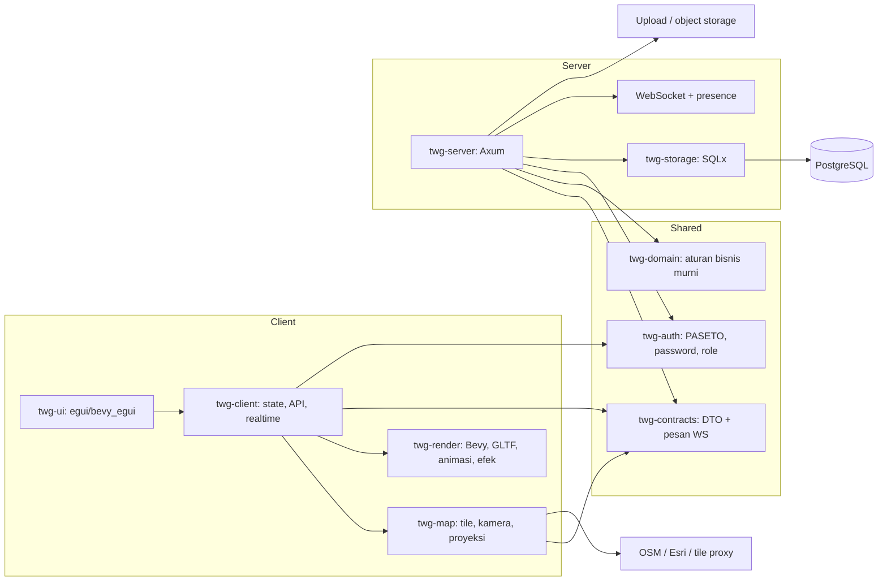

# Rekomendasi Library Rust untuk Migrasi Tactical Game 3D

**Status:** disetujui 4 November 2026 — Axum + SQLx + PostgreSQL, Bevy + egui, `twg-map` dari awal  
**Tanggal analisis:** 4 November 2026  
**Sumber yang dianalisis:** `E:\tactical_game` (read-only)  
**Target:** desktop native Windows/Linux/macOS dan web WebAssembly, client dan server Rust

> Dokumen ini adalah hasil analisis dan rekomendasi. Tidak ada file di
> `E:\tactical_game` yang diubah, dibuat, atau dihapus. Implementasi belum dimulai.

---

## 1. Ringkasan keputusan

Rekomendasi utama:

| Bagian | Pilihan utama | Alasan singkat |
|---|---|---|
| Bahasa/workspace | Satu Cargo workspace Rust | Kontrak client-server dapat dibagi dan dicek compiler |
| Server | **Axum + Tokio + SQLx + PostgreSQL** | Paling dekat dengan pola Go/Gin dan SQL mentah saat ini |
| Auth | **pasetors** (PASETO v2) + **bcrypt** | Kompatibel dengan token dan hash password lama |
| Client | **Bevy + bevy_egui** | Satu renderer dan satu codebase untuk native serta WASM |
| Peta 3D | **crate `twg-map` khusus di atas Bevy**, bukan `maplibre-rs` | `maplibre-rs` masih eksperimental dan belum punya raster/3D terrain |
| UI | **egui/bevy_egui** | Form, panel, tabel, dialog, dan overlay lebih produktif daripada Bevy UI murni |
| Real-time | **WebSocket Axum + `tokio::sync::broadcast`** | Menghapus ketergantungan Centrifugo dan tetap full Rust |
| Build web | **Trunk + wasm-bindgen + wasm-opt** | Alur build WASM yang matang untuk aplikasi Bevy |
| Paket desktop | **cargo-packager** | Menghasilkan installer Windows/macOS/Linux |

### Keputusan penting yang harus disadari

1. **Server relatif mudah dimigrasikan. Client peta 3D adalah risiko utama.**
   MapTalks + Three.js + React Three Fiber menyediakan tile raster, kamera
   pitch/bearing, GLTF, animasi, picking, dan editor. Tidak ada satu crate Rust
   yang menjadi pengganti langsung dan setara untuk seluruh fitur tersebut.
2. **`maplibre-rs` belum layak menjadi fondasi utama.** Proyek itu menyebut
   dirinya eksperimental dan masih kekurangan raster tile, label, simbol,
   GeoJSON, dan 3D terrain. Kebutuhannya justru banyak berada di area yang belum
   tersedia.
3. **`walkers` hanya cocok untuk peta slippy 2D berbasis egui.** Cocok untuk
   prototipe, peta bantu, atau fallback, tetapi bukan untuk 3D GLTF dan kamera
   taktis saat ini.
4. **Bevy adalah pilihan paling realistis untuk satu renderer native + WASM.**
   Konsekuensinya, renderer peta dan banyak widget UI harus dibangun sendiri.
5. **Jika prioritas tunggal adalah hasil tercepat dan paling rendah risiko,
   full-Rust bukan jalur tercepat.** Alternatif hybrid tetap dijelaskan di
   bagian 12 agar keputusan bisa diambil secara sadar.
6. **Jangan melakukan big-bang rewrite.** Migrasi harus bertahap dengan server,
   kontrak, dan client lama berjalan berdampingan sampai client Rust terbukti
   setara.

---

## 2. Temuan baseline proyek

### 2.1 Stack saat ini

| Layer | Teknologi lama |
|---|---|
| Client | React 19 + TypeScript + Vite |
| UI | Tailwind CSS v4 + shadcn/ui + Radix |
| Peta/3D | MapTalks GL + `maptalks.three` + Three.js + React Three Fiber |
| State/data | Context, TanStack Query, Axios, React Router v7 |
| Server | Go 1.24 + Gin |
| Database | PostgreSQL + SQLC |
| Auth | PASETO v2.local, bcrypt, device session, refresh token |
| Real-time | Centrifugo, publish melalui `gocent` |
| Aset | GLTF/GLB, tekstur, skybox, suara, Draco, upload lokal |

### 2.2 Fitur yang harus dipertahankan

- Operasi, skenario, game/latihan, snapshot sesi.
- Lima role: `admin`, `admin_monitor`, `admin_satker`, `user_satker`, `user`.
- Isolasi data berdasarkan `satker_id`, termasuk aturan khusus `satker_id IS NULL`.
- Auth access/refresh token, `X-Device-ID`, session revoke, heartbeat.
- Peta outdoor/indoor, floor plan, grid, base layer OSM/satelit.
- Kamera dengan center, zoom, pitch, bearing, min/max zoom.
- Marker/unit GLTF, rotasi, skala, altitude, model bangunan, line/polygon.
- Animasi route, spawn, remove, combine, sequence, shoot, particle, camera follow,
  zoom, rotasi/skala, text marker, video tron, dan audio.
- Transform marker/line/polygon, draw tool, undo/redo, layer panel.
- Real-time command, last position, last map, snapshot/resume.
- Upload gambar/video, geocoding, ekspor gambar peta.

### 2.3 Batasan kontrak yang perlu dijaga

- Envelope respons: `{ code, message, data }` dan list `{ code, message, data, total }`.
- JSON memakai `snake_case`.
- UUID dan timestamp harus kompatibel dengan data lama.
- `BackendUser.units` memiliki dua bentuk historis: string JSON dan array objek.
  Ini harus dinormalisasi secara sadar, bukan diabaikan.
- Semua aturan role/satker harus tetap ditegakkan di server. Filter di client
  bukan kontrol keamanan.
- Migrasi database yang ada berjumlah 31 pasang (`000001` sampai `000031`) dan
  harus dipertahankan selama fase kompatibilitas.
- Endpoint publik, private, dan admin saat ini sudah memiliki bentuk yang
  dipakai client lama. Perubahan bentuk respons harus melalui versi API.

### 2.4 Aset dan integrasi eksternal

- Tile OSM: `tile.openstreetmap.org` (sumber utama, tanpa API key).
- Tile satelit: ArcGIS World Imagery (opsional).
- Fungsi MapTiler di source lama adalah **dead code** dan tidak dipakai; hapus
  fungsi/key dari client Rust baru. Tidak diperlukan API key untuk OSM.
- Tile proxy server tetap disarankan untuk cache, rate limit, observability, dan
  kebijakan penggunaan OSM—bukan untuk menyembunyikan API key.
- Geocoding: layanan Bali kustom dan Nominatim OSM.
- GLTF/GLB dengan opsi Draco.
- Video, audio, tekstur, skybox, model unit/kendaraan/bangunan.

---

## 3. Arsitektur target



### 3.1 Struktur workspace yang disarankan

```text
tactical_game_rust/
├── Cargo.toml
├── rust-toolchain.toml
├── crates/
│   ├── twg-domain/          # entity, value object, aturan role/satker, error domain
│   ├── twg-contracts/       # DTO HTTP, WS message, API path, serialisasi
│   ├── twg-auth/            # PASETO, bcrypt/argon2, session, policy
│   ├── twg-storage/         # SQLx, repository, transaksi, migrasi
│   ├── twg-server/          # Axum router, handler, middleware, WS, static upload
│   ├── twg-client/          # state aplikasi, HTTP client, cache, auth client
│   ├── twg-map/             # proyeksi, tile quadtree, kamera, picking geospasial
│   ├── twg-render/          # plugin Bevy, material, GLTF, animasi, partikel
│   ├── twg-ui/              # layar, panel, form, tema, widget egui
│   └── twg-asset-pipeline/  # CLI native untuk validasi/konversi aset
├── apps/
│   ├── server/              # binary server
│   ├── desktop/             # binary native winit/Bevy
│   └── web/                 # binary WASM + index.html Trunk
├── assets/
└── tests/
```

Aturan dependensi:

- `twg-domain` tidak boleh bergantung pada Axum, SQLx, Bevy, atau browser API.
- `twg-contracts` hanya berisi tipe dan serialisasi; tidak berisi renderer.
- `twg-server` tidak boleh mengimpor Bevy atau `twg-render`.
- `twg-map` tidak melakukan HTTP langsung; akses tile diberikan melalui trait
  `TileSource` agar mudah diganti, di-cache, dan diuji.
- `twg-ui` tidak mengakses database atau filesystem langsung.
- `apps/*` hanya menjadi composition root dan entry point.

---

## 4. Rekomendasi library per lapisan

Nomor versi di bawah adalah referensi saat dokumen dibuat. Saat implementasi,
pin versi exact di `Cargo.toml` dan `Cargo.lock`; jangan memakai versi floating.

### 4.1 Fondasi bersama

| Kebutuhan | Crate | Alasan/catatan |
|---|---|---|
| Serialisasi | `serde`, `serde_json` | Standar de facto; dipakai server, client, dan kontrak |
| UUID | `uuid` | Tetap kompatibel dengan UUID lama |
| Waktu | `chrono` | Format RFC3339 dan integrasi SQLx/Bevy memadai |
| Error | `thiserror` | Error domain dan error API yang eksplisit |
| Error aplikasi | `anyhow` | Hanya untuk binary/tooling, jangan di kontrak publik |
| Validasi | `validator` atau `garde` | Pilih satu; `validator` lebih umum, `garde` lebih modern |
| Enum string | `strum` | Role, tipe animasi, status, dan konversi aman |
| JSON schema | `schemars` | Dokumentasi/validasi kontrak bila diperlukan |
| Contract test | `insta` | Snapshot JSON untuk mencegah drift |
| Properti geometri | `proptest` | Uji proyeksi, rotasi, dan operasi geometri |
| ID | `uuid` | Gunakan v4 untuk kompatibilitas; jangan ubah format ID lama |

### 4.2 Server

| Kebutuhan | Crate | Rekomendasi dan catatan |
|---|---|---|
| Runtime async | `tokio` | Runtime server; fitur `rt-multi-thread`, `macros`, `net`, `fs`, `signal` |
| HTTP framework | `axum` | Router/extractor/middleware modern; sangat dekat dengan kebutuhan Gin |
| Middleware | `tower`, `tower-http` | CORS, trace, compression, timeout, static file, request limit |
| Database | `sqlx` | Async, SQL eksplisit, compile-time checked query, cocok dengan SQLC |
| Driver | `sqlx` fitur `postgres`, `uuid`, `chrono`, `json`, `migrate` | Tidak perlu `pgx`/driver terpisah |
| Migrasi | `sqlx::migrate!` | Pertahankan file migrasi lama; jangan menulis ulang skema |
| Konfigurasi | `figment` + `dotenvy` | Pengganti Viper dengan layer env/file yang typed |
| Logging | `tracing`, `tracing-subscriber` | Pengganti zerolog; JSON log dan span request |
| Rotasi log | `tracing-appender` | Pengganti lumberjack |
| Password lama | `bcrypt` | Wajib untuk memverifikasi hash bcrypt yang sudah ada |
| Password baru | `argon2`, `password-hash` | Upgrade hash saat login berhasil, jika ingin lebih kuat |
| Token | `pasetors` | Mendukung PASETO v2; gunakan modul `version2` untuk kompatibilitas |
| Random | `rand` | Device/session secret dan nonce |
| Hash token | `sha2` atau `blake3` | Hash refresh token seperti perilaku lama; pilih satu dan dokumentasikan |
| Secret | `secrecy`, `zeroize` | Secret tidak muncul di Debug/log |
| JSON Web Token | `jsonwebtoken` | Tidak wajib; hanya jika ada token JWT di luar PASETO |
| HTTP client | `reqwest` | Geocoding, tile proxy, webhook, object storage |
| Realtime | `axum::extract::ws`, `tokio::sync::broadcast`, `dashmap` | WebSocket server, fan-out per scope, presence |
| Rate limit | `tower_governor` | Login, refresh, upload, publish command |
| Multipart | `axum` fitur `multipart` | Upload gambar/video |
| Batas body | `DefaultBodyLimit`, `tower_http::limit` | Mengganti `MAX_BODY_BYTES` |
| MIME | `infer`, `mime_guess` | Validasi isi upload, bukan hanya ekstensi |
| Storage | `object_store` | Abstraksi lokal/S3-compatible; menghindari upload lokal multi-instance |
| OpenAPI | `utoipa`, `utoipa-swagger-ui` | Dokumentasi API opsional; bukan sumber kontrak client Rust |
| Testcontainers | `testcontainers` | Integration test PostgreSQL |
| Test HTTP | `tower::ServiceExt`, `http-body-util` | Uji router tanpa membuka port |
| CLI | `clap` | Tool migrasi/asset pipeline |

**Mengapa SQLx, bukan ORM:** proyek lama memakai SQL eksplisit dan SQLC. SQLx
mempertahankan kontrol SQL, transaksi, dan performa tanpa memaksa entity graph
ORM. Gunakan `sqlx::query!`/`query_as!` dengan mode offline (`cargo sqlx prepare`)
di CI agar build tidak membutuhkan database aktif.

**Catatan PASETO:** proyek lama memakai `o1egl/paseto` v2.local dengan kunci
simetris 32 byte. Gunakan `pasetors::version2` untuk membaca token lama. Jangan
langsung mengganti ke v4 karena akan memaksa semua sesi login ulang. `pasetors`
juga belum menjalani audit keamanan pihak ketiga; lakukan review dan rotasi kunci.

### 4.3 Client aplikasi dan UI

| Kebutuhan | Crate | Alasan/catatan |
|---|---|---|
| Engine/renderer | `bevy` | Satu codebase native + WASM, ECS, glTF, animasi, audio, picking |
| Integrasi UI | `bevy_egui` | Panel, form, tabel, dialog di atas scene 3D |
| Widget UI | `egui`, `egui_extras` | Tabel, image, layout, widget standar |
| Docking | `egui_dock` | Panel layer, inspector, timeline, console |
| Notifikasi | `egui-notify` | Pengganti toast/sonner |
| Drag and drop | `egui_dnd` | Pengganti dnd-kit untuk daftar UI |
| File picker | `rfd` | Native dan WASM; verifikasi dukungan target web |
| HTTP | `reqwest` | Fitur `json`, `rustls-tls`; target WASM memakai Fetch |
| WebSocket | `ewebsock` | Client WS native + WASM, ringan |
| Async di UI | `bevy_tasks` + channel, atau `bevy_async_task` | Jangan blokir frame UI; bridge future ke Bevy |
| Cache | `lru` (WASM) / `moka` (native) | Cache respons/tile; jangan pakai cache yang butuh thread di WASM |
| Token desktop | `keyring` | Simpan refresh token di OS credential store |
| Token web | cookie HttpOnly, atau `gloo-storage` | Lihat bagian keamanan; jangan menyimpan token sensitif di localStorage tanpa alasan |
| WASM | `wasm-bindgen`, `js-sys`, `web-sys` | Interop browser minimal |
| WASM panic | `console_error_panic_hook` | Debug panic di browser |
| Log WASM | `tracing-wasm` | Terhubung ke tracing subscriber |
| Clipboard | `arboard` (native), `web-sys` (web) | Salin koordinat/teks |
| Image/icon | `egui-phosphor` atau SVG melalui `resvg` | Pengganti ikon Lucide |
| File dialog web | `rfd` atau `web-sys` File API | Verifikasi pada browser target |

**Mengapa bukan Dioxus/Leptos/Tauri sebagai pilihan utama:** Dioxus dan Leptos
sangat baik untuk aplikasi web-first, tetapi jalur desktop biasanya memakai
WebView, bukan renderer native yang sama. Tauri juga memakai WebView. Itu tetap
bisa "Rust untuk logika", tetapi bukan satu renderer Rust native + WASM seperti
yang diminta. Jika target utama adalah form/CRUD dan peta tetap WebGL, Tauri +
Leptos + MapLibre justru lebih rendah risiko, tetapi bukan full-Rust.

**Mengapa egui, bukan Bevy UI murni:** Bevy 0.20 sudah memiliki UI dan widget
editor, tetapi untuk aplikasi data-heavy dengan banyak form, tabel, panel, dan
dialog, ekosistem egui lebih produktif. `bevy_egui` juga memungkinkan scene 3D
dan panel UI memakai satu frame/event loop.

### 4.4 Peta, geometri, dan aset 3D

| Kebutuhan | Crate | Rekomendasi dan catatan |
|---|---|---|
| Proyeksi/tile | implementasi internal `twg-map` | Web Mercator (EPSG:3857), tile quadtree, kamera pitch/bearing |
| Geometri 2D | `geo`, `geo-types` | Buffer, intersect, distance, polygon |
| GeoJSON | `geojson` | Import/export fitur dan building |
| Geodesik | `geographiclib-rs` | Jarak/azimuth akurat untuk measure tool |
| CRS lanjutan | `proj` | **Hanya server/asset pipeline**, bukan WASM; binding native berat |
| Triangulasi | `earcutr` | Polygon building/line fill |
| Tessellation | `lyon` | Line, stroke, path, polygon mesh |
| Spatial index | `rstar` | Picking, query objek, selection 2D |
| Image | `image` | Decode tile PNG/JPEG/WebP |
| Tile cache | `lru`/`moka` + filesystem | Cache memori + cache disk native |
| GLTF | `bevy_gltf` | Loader GLTF/GLB bawaan Bevy |
| Draco | `bevy_gltf_draco` (opsional) | Plugin pihak ketiga; verifikasi versi Bevy dan lisensi. Alternatif: konversi aset ke GLB tanpa Draco |
| Kompresi mesh | `meshopt`/pipeline aset | Kurangi ukuran model untuk web |
| Tekstur web | KTX2/Basis via fitur Bevy | Kompresi GPU lebih baik daripada PNG/JPEG besar |
| Animasi model | `bevy_animation` | Animasi skeletal/clip GLTF |
| Tween transform | `bevy_tweening` | Kamera, marker, dan UI animation; verifikasi kompatibilitas versi |
| Line 3D | `bevy_polyline` atau mesh internal | Rute, garis ukur, annotation |
| Gizmo/measure | `bevy_gizmos` + sistem internal | Transform handle dan alat ukur |
| Picking | `bevy_picking` fitur `mesh_picking` | Klik objek 3D; fallback raycast internal |
| Partikel | `bevy_hanabi` | Native dan WebGPU; **tidak jalan di WebGL2** karena memakai compute shader |
| Partikel fallback | sistem CPU/instanced internal | Wajib jika WebGL2 menjadi baseline |
| Audio | `bevy_audio` + `symphonia` | MP3/WAV/OGG; cek fitur codec pada WASM |
| Video native | FFmpeg melalui `bevy_cutscene`/ffmpeg-next | Decode ke texture; butuh distribusi FFmpeg |
| Video web | `bevy_web_video` atau WebCodecs | Memakai elemen video browser; bukan jalur kode yang identik dengan native |
| Font | `bevy_text`/font embedded | Dukungan Unicode dan font taktis perlu diuji |
| Label peta | billboard/screen-space text internal | Perlu collision/label priority; tidak ada pengganti MapTalks langsung |

**Keputusan peta:** jangan memakai `maplibre-rs` sebagai fondasi. Proyek itu
berguna sebagai referensi arsitektur, tetapi README-nya menyatakan status
eksperimental dan daftar fitur yang hilang mencakup raster, label, simbol,
GeoJSON, dan 3D terrain. `walkers` dapat dipakai untuk peta 2D sederhana, bukan
untuk kebutuhan 3D saat ini.

### 4.5 Real-time

| Kebutuhan | Rekomendasi |
|---|---|
| Protokol | WebSocket JSON dengan versi pesan dan `sequence` per skenario |
| Server | `axum::extract::ws`, `tokio::sync::broadcast`, `dashmap` |
| Presence | Resource `PresenceRegistry` per operasi/skenario, dengan TTL dan heartbeat |
| Reconnect | Exponential backoff + resume dari sequence terakhir |
| Command persistence | Tabel `commands` yang ada tetap dipakai; idempotency key wajib |
| Channel | Channel per satker/operasi/skenario, bukan satu channel global |
| Auth WS | Ticket WebSocket berumur pendek dari endpoint HTTP; jangan taruh access token panjang di query string |
| Pengganti Centrifugo | Lakukan setelah protokol dan test parity siap; Centrifugo boleh dipertahankan sementara sebagai jembatan |

Saat ini command dipublikasikan ke satu channel global dan payload membawa
`satker_id`. Client tidak boleh menjadi satu-satunya pihak yang memfilter data
antar-satker. Implementasi Rust harus memindahkan isolasi ke channel/otorisasi
server dan menguji skenario cross-satker secara eksplisit.

---

## 5. Pemetaan dependensi lama ke Rust

| Lama | Rust | Catatan migrasi |
|---|---|---|
| Gin | Axum | Handler tipis, extractor menggantikan binding manual |
| sqlc | SQLx | Query tetap SQL; gunakan offline mode untuk compile-time checking |
| pgx | SQLx | Pool dan transaksi async |
| Viper | Figment + dotenvy | Dukung `app.env` dan environment produksi |
| bcrypt | `bcrypt` | Hash lama harus tetap valid |
| PASETO Go | `pasetors` version2 | Uji test vector/token lama sebelum cutover |
| Zerolog | tracing | Structured logging dan request ID |
| lumberjack | tracing-appender | Rotasi file |
| gocent/Centrifugo | Axum WebSocket | Perubahan arsitektur; butuh test reconnect dan presence |
| go-playground validator | validator/garde | Validasi request + validasi domain |
| Testify | rstest + pretty_assertions | Unit/integration test |
| React | Bevy ECS + state | Bukan port baris-per-baris |
| React Router | `bevy_state` + route enum | Navigasi layar dan guard role |
| TanStack Query | cache/resource layer di `twg-client` | Invalidasi, retry, dedup request |
| Axios interceptor | middleware HTTP client | Refresh single-flight, device header, error mapping |
| Zod | serde + validator | Kontrak compile-time, bukan runtime schema JS |
| Three.js/R3F | Bevy render | Konsep scene graph/ECS berbeda |
| MapTalks GL | `twg-map` | Harus dibangun dan diuji bertahap |
| `maptalks.three` | `twg-render` | GLTF, line, building, particle |
| Draco JS | preprocess atau `bevy_gltf_draco` | Jangan asumsikan decoder langsung tersedia |
| date-fns | chrono | Format dan timezone harus diuji |
| react-hook-form | state form + validator | Form egui dibuat internal |
| react-table | `egui_extras::TableBuilder` | Sorting/pagination internal |
| dnd-kit | `egui_dnd` | Untuk daftar/layer |
| sonner | `egui-notify` | Toast |
| Lucide | icon font/SVG | `egui-phosphor` atau aset SVG |
| react-share | tidak diperlukan di aplikasi internal | Hapus jika tidak dipakai |
| UUID JS | `uuid` | Format dan versi sama |

---

## 6. Desain renderer peta yang disarankan

### 6.1 Prinsip

- Simpan koordinat geografis sebagai `f64`.
- Konversi ke frame lokal ENU (East-North-Up) di sekitar origin skenario.
- Render memakai `f32` relatif terhadap origin untuk menghindari jitter presisi.
- Pisahkan:
  1. `TileSource`: HTTP/cache/offline.
  2. `TileQuadtree`: pemilihan tile berdasarkan kamera.
  3. `MapCamera`: center, zoom, pitch, bearing.
  4. `MapScene`: tile, building, marker, line, label.
  5. `Picking`: raycast/screen-space selection.
- Jangan mencampur logika UI ke dalam plugin renderer.

### 6.2 Urutan MVP peta

1. Render tile raster OSM/Esri pada bidang Web Mercator.
2. Pan, zoom, pitch, bearing, dan fly-to.
3. Marker dengan koordinat, rotasi, skala, altitude.
4. GLTF marker tunggal dan picking.
5. Line/polygon dan building extrusion.
6. Indoor grid dan floor plan overlay.
7. Label/text marker.
8. Route animation dan camera animation.
9. Efek partikel/shoot dan video.

### 6.3 Target uji kelayakan

Sebelum menulis seluruh aplikasi, buat spike terpisah yang membuktikan:

- Build native dan WASM dari satu crate.
- Tile raster tampil benar di kedua target.
- Kamera pitch/bearing/zoom konsisten dengan koordinat.
- Minimal 1.000 marker/instance dan beberapa model GLTF beranimasi.
- Picking dan transform gizmo berfungsi.
- Tidak ada kebocoran memori tekstur setelah berpindah skenario.
- Ada fallback untuk browser tanpa WebGPU.
- Ukuran bundle dan waktu load dapat diterima.

Gerbang keputusan: jika spike tidak mencapai target frame rate dan stabilitas
yang disepakati, pertimbangkan hybrid (Rust server + MapLibre/MapTalks di
WebView) untuk client, atau tunda fitur 3D paling berat. Jangan memaksa
full-Rust jika hasilnya tidak bisa dipakai secara operasional.

---

## 7. Strategi migrasi bertahap

### Fase 0 — Baseline dan kontrak

- Bekukan skema database dan bentuk respons yang ada.
- Buat golden test untuk seluruh endpoint penting.
- Catat perilaku auth, session, role, satker, error, pagination, dan upload.
- Inventarisasi seluruh pesan WebSocket dan urutan command.
- Siapkan data uji: pengguna per role, operasi, skenario, marker, line, building,
  animasi, snapshot.

**Exit criteria:** test lama dapat dijalankan berulang; tidak ada perubahan
perilaku yang tidak tercatat.

### Fase 1 — Workspace dan shared contracts

- Buat workspace Rust dan crate `twg-domain`/`twg-contracts`.
- Implementasikan DTO, enum role, error, envelope respons, dan WS messages.
- Tambahkan contract test untuk JSON lama.
- Buat adapter kompatibilitas untuk `units` string/array dan timestamp.

**Exit criteria:** DTO Rust menghasilkan JSON yang byte-compatible atau
perbedaannya terdokumentasi dan disetujui.

### Fase 2 — Server read-only

- Implementasikan health, auth, identify, list/detail operasi, skenario, marker,
  line, building, anim, dan public endpoints.
- Hubungkan ke database lama tanpa mengubah skema.
- Jalankan shadow traffic di belakang reverse proxy.
- Bandingkan respons server Go dan Rust.

**Exit criteria:** tidak ada perbedaan kontrak yang tidak disengaja pada endpoint
read-only; session dan role test lulus.

### Fase 3 — Server write dan real-time

- Implementasikan transaksi create/update/delete/copy scenario.
- Implementasikan upload, validasi, dan storage.
- Implementasikan WebSocket, presence, command persistence, dan resume.
- Uji cross-satker, reconnect, duplicate command, dan partial failure.

**Exit criteria:** parity fungsi server; client lama masih dapat bekerja melalui
Rust server.

### Fase 4 — Client shell

- Login, refresh, logout, route guard, dashboard, operasi/skenario CRUD.
- Tema, form, tabel, dialog, notifikasi, file picker.
- Native dan WASM berjalan dari codebase yang sama.

**Exit criteria:** alur non-peta selesai dan dapat dipakai sehari-hari.

### Fase 5 — Peta MVP

- Tile, kamera, marker, GLTF, line, building, indoor floor plan.
- Picking, draw tool dasar, transform dasar.
- Simpan dan muat skenario.

**Exit criteria:** satu skenario nyata dapat dibuat, disimpan, dibuka, dan
diedit di native serta web.

### Fase 6 — Runtime dan editor lanjutan

- Semua tipe animasi, sequence, particle, video, audio.
- Timeline, undo/redo, measure, grid/snap, layer panel.
- Snapshot, last position, replay/AAR.
- Parity fitur berdasarkan matriks fitur.

**Exit criteria:** daftar fitur parity ditutup atau fitur yang ditunda disetujui.

### Fase 7 — Cutover

- Matikan server Go setelah periode pembanding.
- Hentikan Centrifugo jika WS Rust sudah stabil.
- Rotasi secret dan API key.
- Arsipkan source lama, jangan hapus sebelum rollback window berakhir.

---

## 8. Keamanan dan kepatuhan

Prioritas tinggi:

1. **Hapus dead code MapTiler** dari client baru. Aplikasi memakai OSM tanpa
   API key; tile proxy tetap dipakai untuk cache/rate limit.
2. **Jangan menaruh access token panjang di URL WebSocket.** Gunakan tiket
   sekali pakai berumur pendek.
3. **Web:** pertimbangkan refresh token di cookie `HttpOnly`, `Secure`,
   `SameSite`, dengan proteksi CSRF. Jika tetap memakai storage browser,
   dokumentasikan risiko XSS dan gunakan CSP ketat.
4. **Desktop:** simpan refresh token di `keyring`, bukan file teks biasa.
5. **RBAC/satker:** tegakkan di setiap handler dan query, termasuk list, detail,
   command, snapshot, dan upload. Jangan mengandalkan payload `satker_id` dari
   client.
6. **Upload:** batas ukuran, validasi MIME dengan `infer`, nama file generated,
   pisahkan direktori, dan larang eksekusi.
7. **Rate limit:** login, refresh, publish command, upload, dan geocoding.
8. **Logging:** jangan log token, password, cookie, API key, atau payload sensitif.
9. **Dependency:** jalankan `cargo audit`, `cargo deny`, dan review lisensi.
10. **OSM/Esri:** patuhi attribution dan usage policy; jangan mengunduh tile
    secara massal atau menganggap tile publik sebagai layanan tanpa batas.

Catatan: `pasetors` belum diaudit pihak ketiga. Ini bukan alasan untuk
menghindari PASETO, tetapi harus masuk risk register dan diuji dengan test vector
serta review kriptografi.

---

## 9. Build, packaging, dan deployment

### Web

- `trunk` untuk membangun `apps/web`.
- `wasm-bindgen-cli` dan `wasm-opt` untuk menghasilkan wasm yang dioptimalkan.
- Baseline WebGL2; WebGPU opsional dan dideteksi saat runtime.
- Jangan mengaktifkan fitur Bevy `webgpu` secara default jika WebGL2 harus
  didukung, karena fitur itu menggantikan jalur WebGL2.
- Gunakan kompresi Brotli/gzip untuk wasm dan aset.
- Lazy-load model/tekstur; jangan memuat semua aset taktis di awal.

### Desktop

- `cargo-packager` untuk `.msi`/NSIS di Windows, `.dmg`/`.app` di macOS,
  `.deb`/AppImage di Linux.
- Tanda tangani aplikasi Windows dan notarisasi macOS untuk distribusi.
- Gunakan `cargo-dist` untuk binary server/CLI, bukan untuk installer desktop.
- Siapkan code signing dan update policy sebelum distribusi.

### Server

- Binary Rust statis/dinamis sesuai target Linux.
- Reverse proxy TLS (Caddy/Nginx) atau rustls.
- PostgreSQL dikelola terpisah; migrasi dijalankan sebagai job deploy.
- Object storage untuk upload jika ada lebih dari satu instance.
- Health/readiness check dan graceful shutdown (`tokio::signal`).

### CI minimum

```text
cargo fmt --check
cargo clippy --workspace --all-targets -- -D warnings
cargo test --workspace
cargo check --target wasm32-unknown-unknown -p twg-client
cargo audit
cargo deny check
```

Tambahkan build Trunk, build installer desktop, dan smoke test browser di pipeline
terpisah.

---

## 10. Testing dan observability

| Area | Rekomendasi |
|---|---|
| Unit domain | `rstest`, `pretty_assertions` |
| JSON contract | `insta` snapshot |
| Properti geometri | `proptest` |
| HTTP | Router `oneshot` test dengan `tower::ServiceExt` |
| Database | `sqlx::test` + `testcontainers` |
| WebSocket | Test reconnect, ordering, duplicate, cross-satker |
| Renderer | Render ke image + image diff; uji headless Bevy |
| UI | `egui_kittest`/`bevy_egui_kittest` bila kompatibel |
| Browser | `wasm-bindgen-test`; E2E `thirtyfour`/`fantoccini` |
| Performance | `criterion` untuk server; frame profiler `tracing`/`puffin` |
| Load test | `k6`/`oha` sebagai tool eksternal |
| Observability | tracing spans, request ID, metrics Prometheus opsional (`metrics`, `metrics-exporter-prometheus`) |

Jangan mengukur keberhasilan hanya dari kompilasi. Setiap fase harus punya
golden response, test peran/satker, dan test renderer untuk fitur yang
dimigrasikan.

---

## 11. Risiko utama dan mitigasi

| Risiko | Dampak | Mitigasi |
|---|---|---|
| Renderer peta harus ditulis dari nol | Sangat tinggi | Spike lebih dulu; batasi MVP; siapkan opsi hybrid |
| Tile/GLTF/animasi berat di WASM | Tinggi | Budget memori, texture compression, lazy loading, instancing |
| Hanabi tidak berjalan di WebGL2 | Tinggi | Baseline WebGL2 + partikel fallback, atau target WebGPU-only |
| Video texture beda jalur native/web | Tinggi | Tunda fitur video atau buat adapter terpisah; uji Safari/Chrome |
| Draco tidak langsung didukung | Sedang | Preprocess ke GLB non-Draco/meshopt; plugin hanya jika terawat |
| UI React/Tailwind tidak 1:1 dengan egui | Tinggi | Design token, komponen internal, usability test |
| Kontrak JSON berubah | Tinggi | Snapshot test dan masa dual-run |
| Token/session lama tidak kompatibel | Tinggi | `pasetors` v2 + test token lama; rencanakan forced logout jika perlu |
| Cross-satker data leak | Kritis | Channel per scope, query terotorisasi, test negatif |
| `maplibre-rs` belum matang | Tinggi | Jangan jadikan fondasi; gunakan hanya referensi |
| Build time Bevy besar | Sedang | Feature flags, `dynamic_linking` untuk dev, CI cache |
| Web bundle besar | Sedang | `wasm-opt`, split asset, lazy load, compression |
| Aksesibilitas web egui terbatas | Sedang | Uji AccessKit; siapkan fallback UI/DOM jika wajib WCAG |
| Ekosistem crate Bevy berubah cepat | Sedang | Pin versi, minimalkan plugin pihak ketiga, isolasi adapter |
| Dead code MapTiler berisi kredensial | Rendah | Hapus fungsi/key; bukan blocker OSM |

---

## 12. Alternatif yang dipertimbangkan

| Opsi | Kelebihan | Kekurangan | Kapan dipilih |
|---|---|---|---|
| **A. Bevy + egui (rekomendasi)** | Full Rust, native + WASM, GLTF/animasi/audio | Renderer peta/UI harus dibangun; Bevy cepat berubah | Jika full-Rust dan kontrol renderer adalah syarat |
| B. egui + walkers | Cepat untuk peta raster 2D | Tidak ada 3D GLTF/terrain, label terbatas | Prototipe atau aplikasi peta 2D |
| C. Dioxus/Leptos + WebGL | UI produktif, web-first | Desktop lewat WebView; integrasi 3D kompleks | Jika desktop bukan prioritas atau memakai WebView |
| D. Tauri + Leptos + MapLibre | Risiko paling rendah, UI cepat, peta matang | Masih ada JavaScript/WebView; bukan full-Rust | Jika waktu dan stabilitas lebih penting daripada full-Rust |
| E. Bevy + maplibre-rs | Satu stack Rust | `maplibre-rs` eksperimental, tanpa raster/3D terrain | Riset, bukan produk |
| F. Pertahankan client sekarang, Rust server saja | Migrasi bertahap, risiko rendah | Tidak memenuhi target client Rust | Fase transisi atau fallback |

**Rekomendasi realistis:** pilih A hanya setelah spike peta membuktikan
kelayakan. Jika tidak, pilih D untuk client dan tetap gunakan Rust untuk server
serta domain, lalu dokumentasikan bahwa "full-Rust" berarti server/domain Rust,
bukan renderer web.

---

## 13. Keputusan yang perlu disetujui sebelum coding

1. Apakah "semuanya Rust" berarti **renderer dan UI juga Rust**, atau server dan
   domain Rust dengan client WebView diperbolehkan?
2. Apakah WebGL2 wajib didukung, atau WebGPU-only dapat diterima? Ini menentukan
   apakah `bevy_hanabi` dan fitur compute dapat dipakai.
3. Apakah fitur video tron wajib pada rilis pertama?
4. Apakah mode offline/PMTiles diperlukan?
5. Apakah 3D terrain/globe nyata diperlukan, atau cukup model 3D di atas peta
   raster seperti sekarang?
6. Berapa target jumlah unit, building, dan animasi per skenario?
7. Apakah sesi lama harus tetap valid saat cutover, atau boleh memaksa login ulang?
8. OS/arsitektur desktop mana yang harus dirilis lebih dulu?
9. Apakah deployment server boleh memakai object storage, atau upload harus
   tetap lokal?
10. Apakah aksesibilitas web (WCAG) menjadi syarat?

Jawaban atas pertanyaan ini mengubah pilihan library dan urutan fase. Tanpa
jawaban tersebut, rekomendasi utama di atas adalah default yang paling masuk akal.

---

## 14. Rekomendasi langkah berikutnya

1. Setujui atau tolak stack utama: Axum + SQLx + PostgreSQL, serta Bevy + egui.
2. Buat spike `twg-map` terpisah di workspace baru, bukan di `E:\tactical_game`.
3. Siapkan golden contract test dari server Go yang sedang berjalan.
4. Hapus dead code MapTiler dan siapkan tile proxy OSM sebelum client baru memakai tile.
5. Mulai server Rust read-only; jangan menulis ulang renderer penuh sebelum spike
   peta lulus.
6. Baru setelah itu buat client shell, lalu peta MVP, lalu fitur runtime/editor.

---

## 15. Referensi utama

- Bevy: <https://bevy.org/> dan <https://docs.rs/bevy/latest/bevy/>
- Bevy WebGPU/WebGL2: <https://bevy.org/news/bevy-webgpu/>
- egui: <https://docs.rs/egui/latest/egui/> dan <https://github.com/emilk/egui>
- bevy_egui: <https://github.com/vladbat00/bevy_egui>
- Axum: <https://docs.rs/axum/latest/axum/>
- SQLx: <https://docs.rs/sqlx/latest/sqlx/>
- PASETOrs: <https://docs.rs/pasetors/latest/pasetors/>
- maplibre-rs (status eksperimental): <https://github.com/maplibre/maplibre-rs>
- Walkers (peta 2D egui): <https://docs.rs/walkers/latest/walkers/>
- Bevy Hanabi (WebGPU-only di WASM): <https://github.com/djeedai/bevy_hanabi>
- cargo-packager: <https://github.com/crabnebula-dev/cargo-packager>
- ewebsock: <https://github.com/rerun-io/ewebsock>
- Bevy WebGL2/WebGPU: <https://github.com/bevyengine/bevy/tree/latest/examples#webgl2-and-webgpu>
