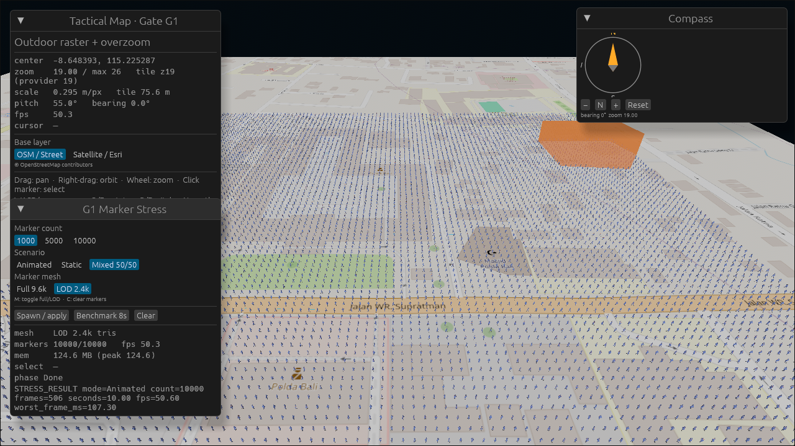
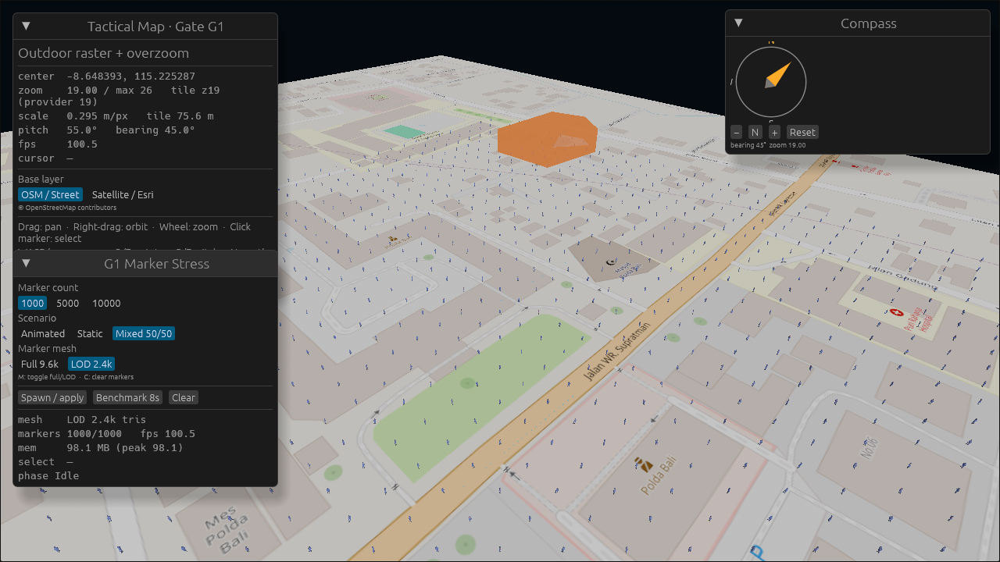
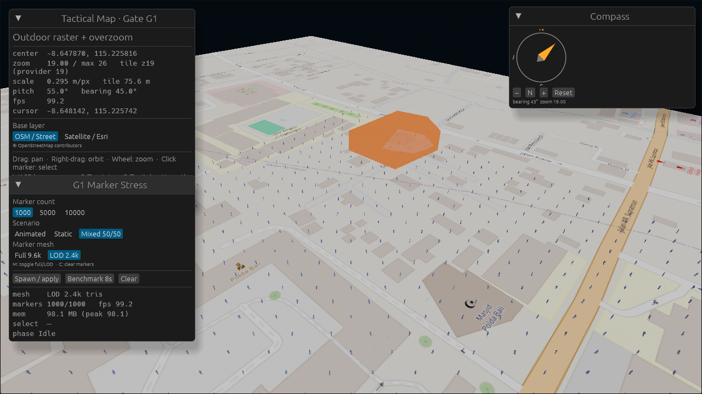
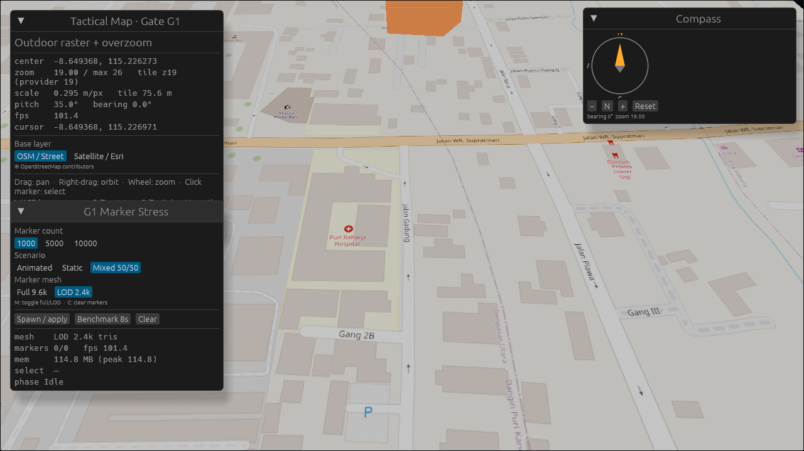
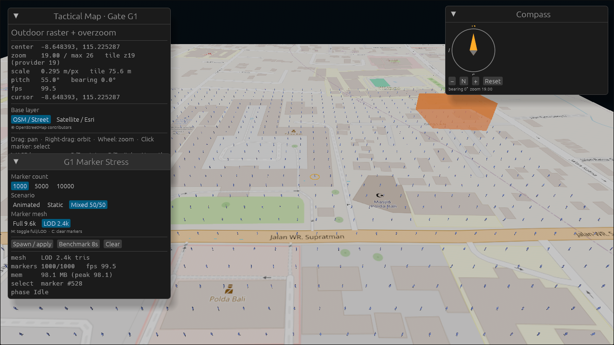
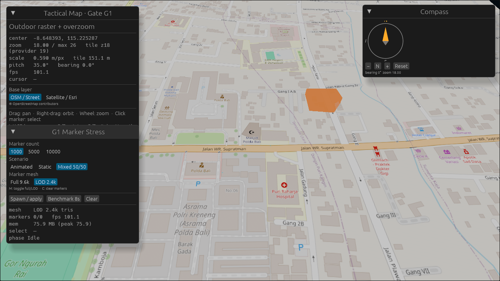
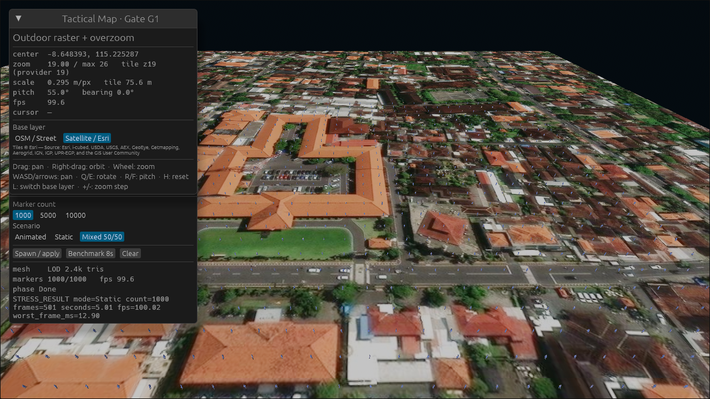

# Laporan Stress Test Web — Gate G1

**Tanggal:** 5 November 2026

**Status:** PASS — 9/9 skenario memenuhi target FPS minimum 25–30 pada Chrome
WebGL2 dengan GPU diskret; minimum 47,19 FPS.

**Build:** `trunk build --cargo-profile wasm-release` (wasm 46 MB, binary OSM +
Esri dan aset `lod2`).

## Lingkungan uji

| Komponen | Nilai |
|---|---|
| CPU | Intel Core i5-11400 @ 2.60 GHz (6 core) |
| GPU | NVIDIA GeForce GTX 1660 Ti |
| RAM | 32 GB |
| OS | Windows 11 Pro 22631 |
| Browser | Google Chrome (headless=new, DevTools Protocol) |
| Renderer WebGL2 | `ANGLE (NVIDIA, NVIDIA GeForce GTX 1660 Ti, Direct3D11 vs_5_0 ps_5_0)` |
| Resolusi | 1280 × 720 |
| Viewport | Zoom 19, pitch 55°, bearing 0° |
| Sampel | Warmup 3 s, sampling 10 s |

Uji dijalankan oleh `tools/web-stress.mjs`. Harness menyalakan static server
untuk `apps/web/dist`, membuka Chrome dengan GPU asli (bukan SwiftShader),
menjalankan kesembilan skenario lewat query string, membaca
`STRESS_RESULT ...` yang dipublikasikan klien ke `document.title`, lalu menulis
JSON, Markdown, console log, dan screenshot.

## Hasil final

| Mode | 1.000 | 5.000 | 10.000 | Target |
|---|---:|---:|---:|---|
| Animated | 99,99 FPS | 88,78 FPS | **50,60 FPS** | ≥ 25–30 |
| Static | 99,99 FPS | 92,10 FPS | **47,19 FPS** | ≥ 25–30 |
| Mixed 50/50 | 98,49 FPS | 94,57 FPS | **48,60 FPS** | ≥ 25–30 |

Semua skenario PASS. Nilai terendah adalah 47,19 FPS pada 10.000 marker tanpa
animasi; marker beranimasi 10.000 justru 50,60 FPS karena update pose dibatasi
5 Hz pada grup besar. Worst frame pada 10.000 marker beranimasi 107,3 ms,
kemungkinan lonjakan saat pergantian pose; FPS rata-rata tetap jauh di atas
target.



Data mentah: [`web-stress-results.json`](web-stress-results.json),
[`web-stress-results.md`](web-stress-results.md), dan
[`web-stress-console.log`](web-stress-console.log).

## Kenapa LOD diperlukan

Model penuh `polwan_airud_walk_non_draco.glb` memiliki 9.628 triangle dan
5.961 vertex. Pada WebGL2, Bevy tidak memakai GPU preprocessing seperti di
native, sehingga throughput triangle jenuh sekitar 1,1 miliar triangle/detik
pada GTX 1660 Ti. Tanpa LOD, hasil web adalah:

| Mode | 10.000 marker, model penuh | 10.000 marker, LOD 2.4k |
|---|---:|---:|
| Animated | 5,60 FPS | 50,60 FPS |
| Static | 11,66 FPS | 47,19 FPS |
| Mixed | 11,44 FPS | 48,60 FPS |

`polwan_airud_walk_lod2.glb` (2.404 triangle) dan
`polwan_airud_idle_lod2.glb` (2.406 triangle) dibuat dari model non-Draco
dengan `gltf-transform weld` + `simplify --ratio 0.25`. Skeleton, bobot skin,
dan clip `Idle|Walk` tetap utuh. Build native masih memakai model penuh secara
default; flag `--stress-lod` atau query web `lod=1` memilih LOD.

## Input web: wheel, pan, LOD, dan selection

Regresi input diperbaiki dan diuji otomatis lewat DevTools Protocol:

| Uji | Hasil | Bukti |
|---|---|---|
| Wheel zoom | PASS | 3 notch masuk: 19 → 19,45; 6 notch keluar: → 18,55. Tidak ada lompatan ke 26/2. |
| Drag/pan | PASS | Pada bearing 45°, drag ke bawah menggeser pusat ke timur laut (lat -8,648393 → -8,647870, lon 115,225287 → 115,225816); drag ke atas mengembalikannya tepat. |
| Toggle LOD (`M`/tombol) | PASS | Full 1.000 marker → LOD 1.000 marker, `ready=1000/1000` setelah reload. |
| Select marker | PASS | Klik tengah layar memilih marker #528; selection ring tampil. |
| Memori load/unload | PASS | Web: 135,8 MB → 135,8 MB; native: lihat tabel memori. |
| Fly-to + kompas | PASS | Double-click menggeser pusat peta (-8,648393, 115,225287) → (-8,649368, 115,226273), pitch 55° → 35°, bearing tetap 0°. |
| Tile proxy | PASS | 81 tile lewat `http://<origin>/tiles/osm/18/...`, tersimpan di Cache Storage; server disk cache juga terisi. |

Penyebab lompatan zoom web adalah delta wheel browser dalam satuan pixel
(~100 per notch) yang dijumlahkan mentah. Input sekarang menormalkan `Line`
dan `Pixel` ke satuan baris, lalu membatasi total per frame ke satu baris
(0,15 level zoom).

Pan diagonal sempat terasa salah pada bearing selain 0°/180°. Rotasi bearing
diterapkan dengan tanda yang berlawanan, sehingga gerak maju/mundur menjadi
miring; pada bearing 0° dan 180° komponen `sin` bernilai nol sehingga bug tidak
terlihat. `pan_by_screen_tiles` sekarang merotasi delta layar dengan bearing
negatif, dan mouse maupun keyboard memakai helper yang sama. Regresi diuji pada
bearing 45°: drag ke bawah bergerak ke timur laut, drag ke atas kembali tepat
ke koordinat awal.

Marker sekarang menyimpan `GeoAnchor` (Mercator point) dan transform-nya
dihitung ulang saat pusat peta berubah. Update dilewati saat kamera diam,
kecuali ada marker baru, sehingga marker selalu menempel pada raster tanpa
membebani benchmark 10.000 marker.







Tombol **Full 9.6k** / **LOD 2.4k** ada di panel stress dan juga bisa diganti
dengan tombol `M`. Saat diganti, aset dan frame animasi dimuat ulang otomatis,
lalu skenario yang sedang aktif dijalankan kembali.

## Picking dan selection

Klik marker memilih marker terdekat dalam radius 26 px dari posisi proyeksi
layar. Marker terpilih mendapat selection ring kuning 3 m dan index-nya tampil
di panel stress. Picking memakai posisi marker, bukan raycast per triangle,
sehingga tetap murah untuk 10.000 marker.



## Memori load/unload

Pengukuran otomatis tersedia lewat `--memory-probe` (desktop) dan `?memory=1`
(web). Probe menunggu scene siap, mencatat memori setelah settle 1 detik, lalu
membersihkan marker dan mencatat lagi.

| Platform | Skenario | Setelah load | Setelah clear |
|---|---|---:|---:|
| Native | 10k static full | 491,9 MB | 500,8 MB |
| Native | 10k static LOD | 489,7 MB | 498,5 MB |
| Native | 10k animated full | 493,5 MB | 501,0 MB |
| Native | 10k animated LOD | 499,7 MB | 503,6 MB |
| Web | 10k static LOD | 135,8 MB | 135,8 MB |

RSS native dan linear memory WASM tidak kembali turun setelah clear karena
alokator dan wgpu menahan buffer. Pengukuran ini menjadi baseline; bila target
memori ketat, langkah berikutnya adalah memaksa unload mesh/material GPU dan
memanggil `shrink` pada alokator.

## Tile cache

Cache tile berlapis:

- **Web:** service worker `apps/web/tile-cache-sw.js` menyimpan respons tile
  OSM/Esri di Cache Storage (`twg-tiles-v1`), cache-first dengan batas 1.500
  entri. Semua navigasi ulang memakai tile yang sudah ada.
- **Native:** fitur Bevy `web_asset_cache` menyimpan unduhan HTTPS di
  `.web-asset-cache/`.
- **Proxy server:** route Axum `GET /tiles/{layer}/{z}/{x}/{y}.png` menyimpan
  respons ke `.tile-cache/<layer>/<z>/<x>/<y>.png`, membatasi konkurensi, dan
  memberi jeda minimum antar permintaan ke provider.
- **Memori:** material dan image memakai LRU 512 entri dengan kunci
  `(layer, tile)`, sehingga berpindah layer dan kembali tidak mengunduh ulang.

Bukti dari run final: 81 permintaan tile pada halaman terakhir, **162 entri
Cache Storage** setelah 9 navigasi. Uji proxy menambah 81 tile lewat route
same-origin sehingga total menjadi **283 entri**; semua tile berasal dari zoom
provider 18–19 (overzoom kamera tetap memakai z19).



## Overzoom sampai zoom 26

Kamera publik tetap `MAX_ZOOM = 26` dan tidak dibatasi oleh zoom provider.
`tile_zoom_for(max_zoom)` memilih zoom tile provider (19 untuk OSM dan Esri),
lalu tile z19 diskalakan secara metrik. Uji pada zoom 23 dan 26 menghasilkan
**hanya permintaan tile z19**:

| Camera zoom | Tile zoom diminta | FPS (1.000 static) | Screenshot |
|---:|---:|---:|---|
| 23 | 19 | 96,19 | [`overzoom-23`](assets/web-stress/overzoom-23-static-1000.png) |
| 26 | 19 | 99,99 | [`overzoom-26`](assets/web-stress/overzoom-26-static-1000.png) |

Ini membuktikan tidak ada permintaan ke level tile yang tidak tersedia dan
gambar z19 tetap dipakai sampai skala kamera 26.

## Multi base layer

Dua layer tersedia dan dapat diganti dari panel UI atau tombol `L`:

| Layer | Template | Provider max zoom |
|---|---|---:|
| OSM / Street | `https://tile.openstreetmap.org/{z}/{x}/{y}.png` | 19 |
| Satellite / Esri | `https://server.arcgisonline.com/ArcGIS/rest/services/World_Imagery/MapServer/tile/{z}/{y}/{x}` | 19 |

Uji layer satelit pada zoom 19: 81 permintaan ke
`server.arcgisonline.com`, semuanya z19, dan imagery tampil benar. Attribution
Esri muncul di panel.

Uji switch runtime dengan menekan `L`: setelah 81 tile OSM dimuat, layer
berpindah ke Esri, 81 tile satelit dimuat, dan Cache Storage naik dari 162 ke
243 entri tanpa menghapus cache OSM. Kedua host muncul di daftar request.




## Draco + LOD

Loader `KHR_draco_mesh_compression` di-vendor sebagai `twg-gltf-draco` dan
aktif di desktop maupun web. Laporan lengkap ada di
[`DRACO_REPORT.md`](DRACO_REPORT.md). Ringkasan sesi web:

| Varian (Animated) | 1.000 | 5.000 | 10.000 |
|---|---:|---:|---:|
| Draco + LOD2 | 99,74 | 54,08 | 26,93 |
| Draco full | 68,35 | 14,26 | 7,23 |

Toggle runtime `D` dan query `?draco=1` diuji PASS. Draco tidak menaikkan FPS
karena kompresi hanya memperkecil unduhan; LOD tetap penentu performa.

## Reproduksi

```bash
cd apps/web
trunk build --cargo-profile wasm-release
cd ../..
node tools/web-stress.mjs --sample=10 \
  --wheel-test --pan-test --lod-toggle-test --draco-toggle-test \
  --select-test --memory-test --fly-test --proxy-test
```

Uji proxy memakai route same-origin dari static server harness dan meneruskan
`/tiles/*` ke `TILE_PROXY_BACKEND` (default `http://127.0.0.1:8010`).

Uji overzoom dan satelit:

```bash
node tools/web-stress.mjs --tag=draco-lod --lod=1 --draco=1 --sample=10
node tools/web-stress.mjs --tag=draco-full --lod=0 --draco=1 --sample=10
node tools/web-stress.mjs --tag=overzoom-23 --only=static:1000 --zoom=23 --sample=5
node tools/web-stress.mjs --tag=overzoom-26 --only=static:1000 --zoom=26 --sample=3
node tools/web-stress.mjs --tag=satellite --only=static:1000 --zoom=19 --layer=satellite --sample=5
node tools/web-stress.mjs --tag=layer-switch --only=static:1000 --sample=3 --switch-layer
```

Native:

```powershell
$env:TWG_ASSET_PATH = "F:\twgrev\assets"
cargo run -p twg-desktop --release -- `
  --stress animated --count 10000 --benchmark --warmup 2 --sample 5 --exit
```

Hasil native pada mesin yang sama. LOD, 9 skenario (warmup 1 s, sample 3 s):

| Mode | 1.000 | 5.000 | 10.000 |
|---|---:|---:|---:|
| Animated | 232,14 FPS | 214,87 FPS | **146,59 FPS** |
| Static | 225,65 FPS | 245,84 FPS | **195,39 FPS** |
| Mixed 50/50 | 213,66 FPS | 219,81 FPS | **175,15 FPS** |

Model penuh 9,6k triangle pada 10.000 marker (warmup 2 s, sample 5 s):
**45,69 FPS animated**, **54,29 FPS static**. Update pose native dibatasi 10 Hz
untuk grup besar; LOD memberikan margin jauh di atas target. Native memakai GPU
preprocessing, sehingga hasil LOD jauh lebih tinggi daripada web.

## Batasan yang tersisa

- Uji web hanya di Chrome/Chromium WebGL2. Firefox, Safari, Edge, dan GPU
  integrated belum diukur.
- WebGPU belum diuji; WebGL2 adalah jalur aktual pada build ini.
- Bundle WASM release masih 46 MB; optimasi `wasm-opt`, code splitting, dan
  kompresi Brotli masuk fase packaging.
- Memori sudah diukur, tetapi RSS/WASM tidak turun setelah clear. Strategi
  unload GPU dan `shrink` alokator belum diterapkan.
- Tile proxy server-side sudah ada, tetapi deployment produksi tetap perlu
  konfigurasi quota/attribution dan pemantauan cache.
- Object picking, selection ring, line, polygon, building extrusion, dan floor
  plan sudah tersedia. Authoring interaktif belum termasuk Gate G1 ini.
